# README

Readipedia 是 Readify 的「书籍百科」站：把一本书做成一部可以浏览的百科，有书库、书籍概览、词条、知识图谱、故事线和 StoryFlow，并把读者引流到 Readify 去读原书和听书。

本文按 `cleanup` 分支的现有代码逐页核对后写成，只看这一份文档，就能做出一个外观、交互、动效都一样的网站。文中的文件名和行为都以代码为准；代码和文档不一致时，以代码为准并请更新本文。

> 本仓库是**功能需求和交互体验的原型**，不是生产代码。它是纯静态站，数据全部打包在前端 JS 里，只有《一九八四》（Nineteen Eighty-Four）一本书有完整内容。正式开发时，界面和交互照做，数据层按第 10 节换成后端接口。


---

## 目录

1. [产品定位与范围](#1-产品定位与范围)
2. [技术结构与本地预览](#2-技术结构与本地预览)
3. [页面清单与路由](#3-页面清单与路由)
4. [全局框架：页头、侧边栏、页脚、断点](#4-全局框架页头侧边栏页脚断点)
5. [逐页说明](#5-逐页说明)
6. [全局功能](#6-全局功能)
7. [动效与交互规范](#7-动效与交互规范)
8. [设计 token](#8-设计-token)
9. [数据结构](#9-数据结构)
10. [后端接口建议](#10-后端接口建议)
11. [已知限制与问题](#11-已知限制与问题)
12. [交互优先级总表](#12-交互优先级总表)
13. [截图索引](#13-截图索引)

每个交互后面都标了实现优先级：

| 标记 | 含义 |
|---|---|
| 【必须】 | 产品核心功能，正式版必须实现，行为要和原型一致 |
| 【演示】 | 为了演示效果或某次运营活动做的，数据或链接是占位的，正式版按业务需要重做或去掉 |
| 【可选】 | 体验加分项，原型里有，正式版可以排在后面做 |

---

## 1. 产品定位与范围

### 1.1 设计原则（所有页面适用）

这些是产品负责人 Mark 定的规则，评审时按这几条验收：

1. **UI/UX 全面对齐 [transitions.dev](https://transitions.dev)（下文简称 td）。** 不只复用 td 的组件和设计 token，td 网站本身的布局、排版、交互和动效也尽量照做。代码注释里写着「transitions.dev」的地方，就是照 td 某个具体组件做的。
2. **不要套框。** 不做卡片套灰台、外框、阴影卡片的层层嵌套。
3. **不写说明性废话。** 标题下不放解释文字，不展示没用的字段。
4. **同一功能只留一套控件。** 不做和侧边栏重复的导航、按钮、返回链接。
5. **不加工原始数据。** 故事线、StoryFlow 等文本按原始数据原样展示，不改写、不摘要。
6. **桌面、笔记本、平板、手机体验一致**，深色模式同样要好看。

### 1.2 范围

| 模块 | 说明 |
|---|---|
| 书库 | 全部书籍、全部词条、14 个分类页，带筛选和分页 |
| 书籍百科 | 只有《一九八四》一本：概览、149 个词条、知识图谱、89 个故事线场景、3 条 StoryFlow |
| 其他书籍 | 只在书库和搜索里出现，点开跳到 readifyai.com 对应页面 |
| 引流 | 页头「Open Readify」、下载菜单、词条和书籍页的「Read the book in Readify」按钮、页脚、促销卡片 |
| 语言 | 英文、中文两种；日、西、法语在菜单里是灰色不可选的占位 |
| 主题 | 浅色、深色、跟随系统 |

### 1.3 哪些数据是真的，哪些是占位

| 数据 | 状态 | 来源 / 说明 |
|---|---|---|
| 《一九八四》概览、情节、主题、背景与影响、作者 | 真实 | 从 readifyai.com 抓取，`data/wiki_store.js` |
| 149 个词条的英文正文、配图 | 真实 | 同上；每个词条一张图 |
| 149 个词条的中文正文 | 真实 | `data/wiki_articles_zh.js`，切到中文时才加载 |
| 知识图谱节点和关系（149 节点，2204 条边） | 真实 | `master.knowledge_graph` |
| 89 个故事线场景（日期、标题、全文、配图），中英文 | 真实 | `master.storylines` 和 `WIKI_STORE_ZH.storylines` |
| 3 条 StoryFlow，每条 5 个节点 | 真实 | `data/storyflows_complete.js`；节点正文只有英文 |
| 书库 68 本书（含本站的《一九八四》）、16 个分类、中英文书名和作者 | 真实快照 | 2026 年 10 月照 readifyai.com/zh/books 抄录，`data/library.js` |
| 书库「热门」顺序 | 真实快照 | Readify 书库首屏顺序，写死在 `popular` 数组 |
| 其他书籍的封面 | **占位** | 没有封面图，用灰底加书名的文字封面代替 |
| 其他书籍的词条（9 条，都是《伊甸之东》） | 真实样例 | 只为演示「全部词条」里混排其他书 |
| 词条「热门度」 | **代用指标** | 用图谱连接数（出度 + 入度）排序，不是真实浏览量 |
| 书籍页右侧的作者、国家、语言、类型、出版日期 | **写死在 HTML** | 只适用于这一本书 |
| 侧边栏的 149 个词条链接 | **写死在 HTML** | `index.html` 里静态生成，正式版应由数据渲染 |
| StoryFlow 列表的 3 张卡片 | **写死在 HTML** | 按顺序和数据里的 id 对应 |
| 促销卡片的文案、5 个 A/B 版本、截止时间 | **演示** | 运营活动占位，截止时间写在 `data-end` |
| macOS、Windows 下载链接 | **空** | 菜单里显示但点了没反应 |
| 下载菜单里的二维码 | **演示** | 调用外部服务 api.qrserver.com 现场生成 |
| 页脚「Free tools」四项 | **占位** | 纯文字，没有链接 |
| 词条缺正文时的兜底文字 | **占位** | 代码里的一段通用英文模板，当前 149 个词条都有正文，不会出现 |

---

## 2. 技术结构与本地预览

### 2.1 技术栈

- 纯静态 HTML + CSS + 原生 JS，没有框架，没有构建步骤。
- 第三方库都放在 `assets/vendor/`，本地加载：
  - `force-graph.min.js`：知识图谱画布（基于 d3-force 的 Canvas 力导向图）
  - `marked.min.js`：把词条和 StoryFlow 的 Markdown 渲染成 HTML
  - `lucide.min.js`：图标库，现在只作兜底（常用图标已由 `app.js` 里的 `UI_ICONS` 自绘）
  - `border-beam.js`：Readify 按钮外圈流光，来自 libraries.dev 的 border-beam 1.4.1（MIT），改写成不依赖 React 的纯 CSS 版本
- 字体：Inter 可变字体，自托管在 `assets/fonts/`（SIL OFL）。

### 2.2 本地预览

```bash
git clone https://github.com/marksheng00/wiki.git
cd wiki
git checkout cleanup
python3 -m http.server 8765
# 打开 http://localhost:8765/
```

必须用 HTTP 服务器打开，直接双击 `index.html` 会因为 `<base>` 和真实路径路由失效。

### 2.3 目录结构

```
index.html                 唯一的页面模板：页头、侧边栏、所有视图的骨架、搜索面板、页脚
app.js                     主控制器：路由、历史记录、语言、主题、知识图谱、搜索、词条页、手势
library.js                 书库：全部书籍、全部词条、分类页、筛选、分页、书库侧边栏
story.js                   故事线（缩略图、滑动）、StoryFlow 页和弹出层、词条页的「相关 StoryFlow」、手机书籍页的热门词条胶囊
promo-banner.js            促销卡片：A/B 文案、倒计时、关闭、埋点
style.css                  全站样式和所有设计 token（:root）
library.css / story.css / promo-banner.css / pro-gradient-text.css   各模块样式
data/
  wiki_store.js            英文主数据（书、作者、概览、图谱、故事线、StoryFlow 列表、词条正文、图片映射），约 1.9 MB
  wiki_store_zh.js         中文：书籍正文、作者、故事线、StoryFlow 标题、图谱节点中文名、分类中文名
  wiki_articles_zh.js      中文词条正文，约 780 KB，切到中文时才动态加载
  storyflows_complete.js   3 条 StoryFlow 的完整节点
  entity_storyflows.js     词条 → 相关 StoryFlow id 的映射
  library.js               书库数据（书、分类、热门顺序、其他书的词条）
  其余 .json / .md / .pdf / wiki_articles/ / entities_deep/ 等  原始抓取数据，运行时不加载，保留作数据源
assets/
  images/                  词条图、故事线图、StoryFlow 图、封面（全尺寸）
  images/graph/            图谱节点用的 256px 小头像
  brand/                   favicon、促销卡片的 5 张背景画
  fonts/  vendor/
books/  entries/  categories/<id>/     预渲染的书库静态页（见 2.5）
tools/
  prerender-library.js     生成书库静态页和 sitemap
  make-graph-thumbs.sh     生成 256px 图谱头像
docs/                      评审记录和本文截图
```

### 2.4 脚本加载顺序

所有脚本都是 `defer`，按下面顺序执行（顺序有依赖，不能乱）：

```
lucide → marked → force-graph
→ data/wiki_store.js → data/wiki_store_zh.js → border-beam.js
→ data/storyflows_complete.js → data/entity_storyflows.js
→ story.js → data/library.js → library.js → app.js → promo-banner.js
```

`<head>` 里有一段内联脚本，在 CSS 之前执行，作用是避免闪烁：

- 读 `localStorage['readipedia-theme']`，立刻给 `<html>` 设好 `data-theme`。
- 如果地址不是书籍页，给 `<html>` 加 `is-routing`，把默认的书籍页先藏起来；如果是书库地址，再加 `is-routing-library`，让侧边栏先显示书库导航。`app.js` 路由完成后去掉这两个 class。

CSS 和 JS 链接都带 `?v=数字` 做缓存版本号，改了文件要手动加一。

### 2.5 预渲染脚本 `tools/prerender-library.js`

书库页要被搜索引擎抓取，所以除了前端渲染，还把每个书库页预先生成一份静态 HTML：

```bash
python3 -m http.server 8765 &
node tools/prerender-library.js [--base http://localhost:8765/] [--origin https://正式域名/] [--lang en]
```

- 需要 Playwright（`npm i -g playwright`）。
- 它用无头浏览器打开网站，从书库侧边栏出发，把所有书库页和分页都走一遍，每页复制一份 `index.html`，把 `<base href>` 改成回到站点根目录的相对路径（如 `../../`），填好书库内容和侧边栏，写上独立的 `<title>` 和 `<link rel="canonical">`。
- 生成前会先删光 `books/`、`entries/`、`categories/` 三个目录，避免残留。
- 加了 `--origin` 时，canonical 用绝对地址，并在根目录生成 `sitemap.xml`。
- **改了 `index.html`、书库数据或书库代码后，要重新跑一次**，否则静态页里是旧内容。

当前生成结果：`books/`、`books/page/2/`、`entries/`、14 个 `categories/<id>/`。

`tools/make-graph-thumbs.sh` 在新增或替换词条图片后运行，从全尺寸图生成 `assets/images/graph/` 下的 256px 头像（macOS 用 sips，其他系统用 ImageMagick）。

---

## 3. 页面清单与路由

### 3.1 路由表

站点有两种地址：书库用真实路径（可被抓取），书籍百科用 `#` 哈希路由。

| 页面 | 地址 | 说明 |
|---|---|---|
| 站点根 | `/` | 自动替换为 `books/`（不新增历史记录） |
| 全部书籍 | `books/`，第 n 页 `books/page/<n>/` | 书库首页，Logo 点进来就是这里 |
| 全部词条 | `entries/`，`entries/page/<n>/` | |
| 分类 | `categories/<id>/`，`categories/<id>/page/<n>/` | id 见 9.6，空分类（business、computing）不出页面 |
| 书籍概览 | `#book` | 《一九八四》百科首页 |
| 词条 | `#<entityId>` | 例：`#character-recall-character-julia-dd9a6077f139`；也接受英文名（不区分大小写），如 `#Julia` |
| 故事线 | `#view-storyline`，或 `#storyline/<index>` 定位到某个场景 | index 从 1 到 89 |
| StoryFlow 列表 | `#view-storyflow` | |
| 单条 StoryFlow | `#storyflow/<flowId>` | |

在书库静态页上点进书籍百科，会回到根路径再加哈希（如 `/#book`），由 `<base>` 保证相对链接都从根目录算。

### 3.2 旧地址兼容

| 旧地址 | 现在打开 | 地址栏 |
|---|---|---|
| `#all-books`、`#books`、`#view-library`、空哈希 | 全部书籍 | 换成 `books/` |
| `#all-entries`、`#entries` | 全部词条 | 换成 `entries/` |
| `#all-books/<n>`、`#all-entries/<n>` | 对应分页 | 换成 `books/page/<n>/` 等 |
| `#categories/<id>`、`#categories/<id>/<n>` | 对应分类页 | 换成 `categories/<id>/…` |

`#books`、`#entries` 原来是「热门书籍」「热门词条」两个标签，现在合并进全部书籍和全部词条（它们本来就按热门排序）。

### 3.3 历史记录和刷新【必须】

- 每次进入新页面用 `pushState` 记一条历史，浏览器返回和前进可用，`popstate` 时按记录恢复页面。
- 故事线换场景用 `replaceState`，所以返回键直接离开故事线页，不会一个场景一个场景地退。
- 刷新后停在地址对应的页面。滚动位置不恢复（`history.scrollRestoration = 'manual'`），每个页面从顶部开始。
- 每个页面有自己的标签页标题：书库页为「全部书籍 · 书库 — Readipedia」「All books · Page 2 · Library — Readipedia」这类格式；离开书库后恢复为「Nineteen Eighty-Four — Readipedia」或「一九八四 — Readipedia」。

### 3.4 页面切换的公共行为【必须】

切换页面时（`showArticleView`）：

1. 隐藏所有视图，显示目标视图。
2. 同步侧边栏高亮（Overview / Storylines / StoryFlow / 当前词条）。
3. 书籍页显示书的目录，词条页显示词条目录，其他页面收起目录。
4. 故事线和 StoryFlow 列表页给正文区加 `wide-stage`。
5. 滚回顶部，关闭手机菜单，播放进场动效（7.3「页面进场」）。
6. 书库内部换页（换分类、换页码）不滚动也不播进场动效，只刷新书单，和 td 的书库筛选一样。

---

## 4. 全局框架：页头、侧边栏、页脚、断点

### 4.1 断点

| 宽度 | 布局 |
|---|---|
| ≤ 768px | 手机：页头只留 Logo 图标、搜索、Open Readify、菜单按钮；侧边栏变成全屏菜单；图谱有浮动按钮 |
| 769–960px | 小平板：侧边栏和正文间距从 56px 缩到 32px，隐藏页头「Open Readify」和快捷键提示 |
| 769–1100px | 窄桌面：全部词条两列；促销卡片改成两行紧凑版 |
| ≥ 1024px | 书籍页右侧信息栏上移，和书名顶部对齐 |
| ≤ 1080px 且有触屏 | 在侧边栏顶部下拉可以展开图谱（平板也生效） |
| 高度 ≤ 500px（手机横屏） | 图谱下方词条露出高度固定 104px |

折叠屏和双屏：

- 展开折叠屏跨过 768px 时，如果手机菜单开着，会无动画关掉，折回来不会再打开。
- 宽度变化（折叠、展开、旋转）时，正在读的那一行保持在屏幕同一位置，而不是保持同一个像素偏移（见 6.10）。
- 双屏设备横跨两块屏幕时（CSS `horizontal-viewport-segments: 2`，如 Surface Duo），侧边栏留在左屏，正文移到右屏，不让文字压在铰链上。
- 书单列数随宽度自动变（手机最小 96px 一列），所以折叠屏外屏两列，普通手机三列，宽屏更多。

### 4.2 页面网格（桌面 ≥ 769px）

照 td 文档页的网格：

- 页面最大宽度 1192px，居中；左右留白 `max(24px, (100vw - 1192px) / 2)`。
- 页头高 68px，固定在顶部，背景和页面同色，无边框。
- 侧边栏宽 200px，固定不随页面滚动，距页头 32px。
- 侧边栏和正文间距 56px（769–960px 为 32px）。
- 正文区 = 剩余宽度。书籍页、词条页的正文不限宽，右侧浮动信息栏；其他文字段落最大宽 686px。

手机（≤ 768px）：左右边距 20px，正文距页头 24px。

### 4.3 页头

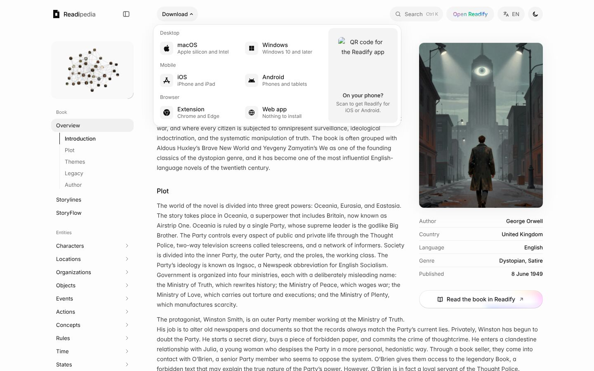

桌面从左到右：

| 元素 | 行为 | 优先级 |
|---|---|---|
| Logo（折角书页图形 + 「Readi」深色「pedia」灰色） | 点击回到书库首页 `books/`。鼠标悬停时右上角折角沿折线翻平（仅桌面、侧边栏展开、精确指针、未开减少动态效果） | 【必须】，翻角【可选】 |
| 收起侧边栏按钮 | 在 Logo 所在格子的右端（与侧边栏右边对齐）。点击后侧边栏滑出并模糊消失，正文区左移占满；Logo 文字收起只剩图标；此时鼠标移到 Logo 图标上，图标淡出变成这个按钮，再点展开。状态不保存，刷新后恢复展开。悬停有 tooltip「Hide sidebar / Show sidebar」 | 【必须】 |
| Download 下拉 | 鼠标悬停 80ms 后打开，离开 160ms 后关闭；也可点击开关；Esc 或点别处关闭。见 6.7 | 【演示】（链接待补） |
| 搜索框按钮 | 灰色胶囊「Search Ctrl K」，Mac 上显示 ⌘K。点击打开搜索面板。见 6.1 | 【必须】 |
| Open Readify | 渐变文字按钮。按访问设备改文案和图标，见 6.7 | 【必须】 |
| 语言按钮 | 地球图标 + 「EN / 中文」，点击打开语言菜单，见 6.2 | 【必须】 |
| 主题按钮 | 月亮/太阳图标，在浅色和深色之间切换，见 6.3 | 【必须】 |

手机：只留 Logo 图标（无文字）、搜索圆按钮、Open Readify、菜单按钮。语言和主题移到菜单里。菜单按钮是两条横线，打开时两线合成 ✕（300ms），页头始终在菜单之上，同一个按钮负责开和关。

### 4.4 侧边栏（桌面）

侧边栏有两种内容，按当前页面切换：

**书库页**（全部书籍、全部词条、分类）：

```
Library
  All books           ← 当前页灰底高亮
  All entries
Categories
  Fiction / Literature / … / Education   （只列有书的 14 个分类）
```

书库页不显示知识图谱。

**书籍百科页**（概览、词条、故事线、StoryFlow）：

```
[知识图谱小窗 200×140]
Book
  Overview
    ├ Introduction / Plot / Themes / Legacy / Author   ← 只在书籍页展开，竖线上有滑动指示条
  Storylines
  StoryFlow
Entities
  Characters ›   （可折叠，默认收起）
    Winston Smith
    Julia        ← 当前词条
      ├ Summary / Identity and Introduction / …   ← 当前词条的目录
    …
  Locations › / Organizations › / Objects › / Events › / Actions ›
  Concepts › / Rules › / Time › / States › / Expressions ›
```

- 行高 32px，圆角 12px，悬停浅灰，当前页深一点的灰。分组标题 11px 灰字。
- 数量（如 18、149）只给屏幕阅读器和搜索用，不显示。
- 「Entities」是固定标题，不能折叠；下面每个类别可折叠，右侧箭头向右，展开时转 90°。折叠动画见 7.3「折叠面板」。
- 打开某个词条时，自动展开它所在类别并高亮。
- 侧边栏自己滚动，滚到底不会带动页面（`overscroll-behavior: contain`）；鼠标在图谱等非列表区域滚轮也不会滚页面。滚动条隐藏。

**目录（书籍页和词条页）**【必须】：

- 书籍页目录挂在 Overview 下面，词条页目录挂在该词条链接下面。左边一条 1px 竖线，当前章节有一条深色指示条沿竖线滑动（td tabs 动效，250ms）。
- 滚动时自动高亮：以页头下方 120px 为基准线，最后一个越过基准线的章节为当前章节。
- 点击目录项平滑滚动到章节（停在页头下方 24px），之后 900ms 内不让滚动监听覆盖高亮，避免跳动。
- 词条目录取正文里的二级标题；少于 2 个时取二、三级标题。如果正文不是以标题开头，第一项是「Summary」（指向页面顶部）。词条末尾的「Related StoryFlow」也会进目录。
- 在别的页面点书籍目录，先打开书籍页，等 350ms 再滚动。
- 手机不显示这两个目录。

### 4.5 手机菜单

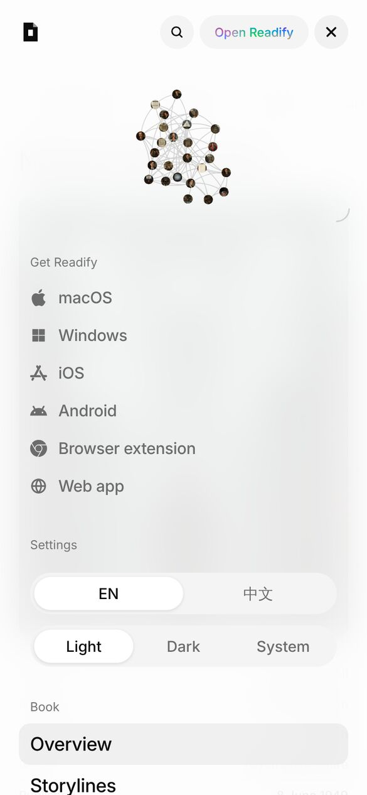

点页头菜单按钮打开，是全屏面板：

- 背景是 90% 不透明的页面色加 20px 背景模糊，能隐约看到下面的页面（td 手机菜单的做法）。
- 打开：面板 400ms 淡入不滑动，里面每一行依次从下方 12px、模糊 3px 升起，间隔 40ms，最多延迟到 240ms。关闭：整体 200ms 淡出，不回放。
- 内容顺序：知识图谱预览（160px 高，无底框）→ Get Readify（6 个下载入口，当前设备带蓝色「This device」标签）→ Settings（语言两段切换 EN / 中文，主题三段切换 Light / Dark / System）→ 页面导航（书库导航或书籍导航，字号放大：一级 20px，二级 17px 灰色）。
- 关闭方式：再点菜单按钮（已变成 ✕）、点遮罩、在菜单上向左滑、点任意导航项。
- 在文章页从左向右滑动（≥ 60px、水平为主、600ms 内）打开菜单。
- 菜单滚到顶部时向下拉（≥ 35px）直接把图谱展开成全屏。

### 4.6 页脚

每页底部（正文区内）：

- 左：Logo（灰色）、标语「Read the book as a living encyclopedia.」（中文「把一本书读成一部活的百科」）、「Made by Readify」链接到 readifyai.com。
- 右：四列链接 Product（iOS / Android / macOS / Windows / Web / Chrome 扩展 / Android APK）、Readify（About / Contact / Blog / Resources / Pricing）、Legal（Privacy / Terms）、Free tools（四项纯文字占位）。
- 底部一条细线，左边版权「© 2026 Readify. All rights reserved.」，右边 Discord、X、Instagram、YouTube 四个 32px 圆形图标按钮。
- 手机：四列变两列网格，版权和社交图标上下排列（图标在上）。
- 页脚 Logo 点击和页头 Logo 一样回书库。

### 4.7 回到顶部按钮【可选】

- 仅桌面。页面滚过 0.6 屏后出现，右下角 40px 处，36px 灰色圆按钮。
- 出现和消失用 td Toast 动效：从下方 16px、缩放 0.97、模糊 2px 升起，350ms 进、250ms 出。
- 手机上隐藏，由图谱浮动按钮占这个位置。

---

## 5. 逐页说明

### 5.1 全部书籍 `books/`【必须】

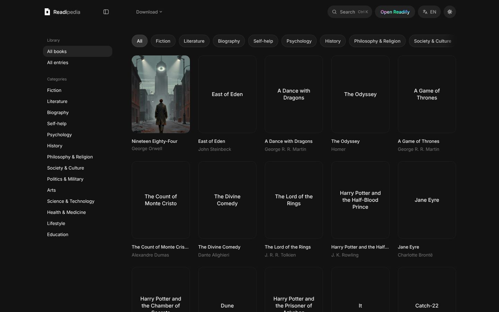

结构从上到下：

1. 隐藏的 h1「All books」（只给屏幕阅读器和搜索引擎，侧边栏已标明当前页，不重复显示标题）。
2. 分类筛选条：All + 有书的分类，td 的筛选胶囊样式（见 8.5）。一行排不下时横向滚动，右侧渐隐。
3. 书单网格：每格最小 140px，行距 28px、列距 24px；手机每格最小 96px，行距 24px、列距 12px。
4. 分页器：超过 48 本时出现。

**排序**（固定，没有排序控件）：本站的《一九八四》排第一 → `popular` 数组里的 14 本按其顺序 → 其余按数据里的分类顺序。

**书卡**（td 书库卡片去掉外框）：

- 封面：3:4，圆角 14px（手机 12px），灰底加 1px 内描边。《一九八四》显示封面图；其他书没有封面，居中显示书名（15px 中粗，最多 4 行）。
- 封面下：书名（13px 中粗，单行省略），作者（13px 灰色，单行省略）。
- 悬停：封面底色加深 3%（图片封面亮度降 3%）；外站书的书名末尾出现一个 ↗ 小箭头（从左下滑入，粘在最后一个字上，不会单独换行）。手机不显示箭头。
- 点击：《一九八四》进入书籍概览 `#book`；其他书在新标签打开 `https://readifyai.com/<en|zh>/books/<书名>`（中文用中文书名，英文用英文书名）。

**筛选**：点胶囊在当前页内过滤，只重放书单的出现动效，不滚动；如果当时在第 2 页以后，回到第 1 页。切换页面（换侧边栏项）时筛选重置为 All。

**出现动效**：书和词条滚进视口时依次从下方 12px、模糊 3px 升起（500ms，间隔 40ms，最多 24 个）。刚打开页面时首屏内容直接显示（已有页面进场动效），之后滚进来的才播。

### 5.2 全部词条 `entries/`【必须】

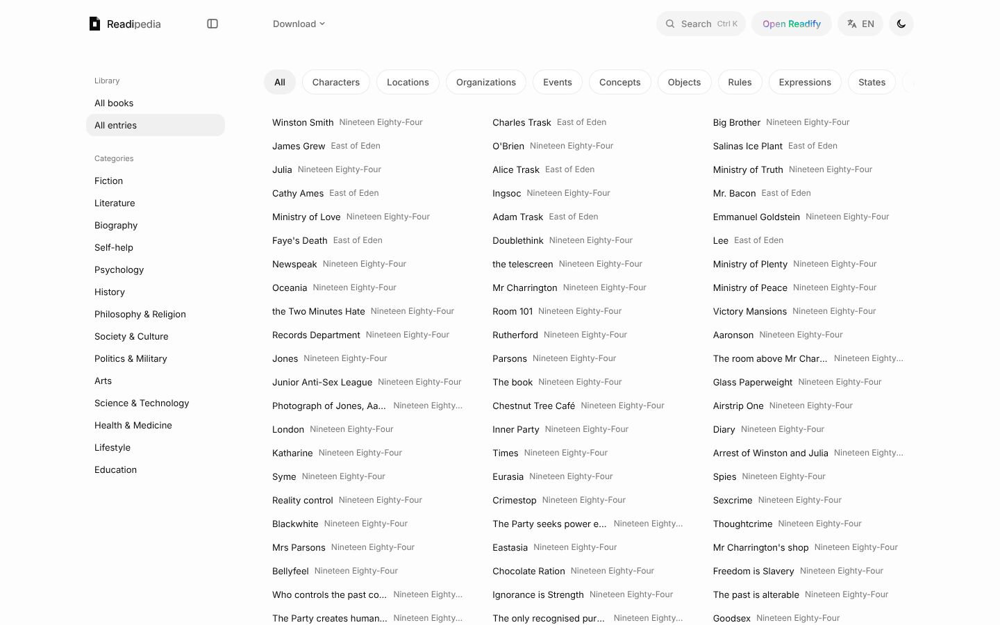

1. 隐藏的 h1「All entries」。
2. 类型筛选：All / Characters / Locations / Organizations / Events / Concepts / Objects / Rules / Expressions / States / Actions / Time / Creatures（只列有数据的类型，中文用 `category_names` 的译名）。
3. 词条列表：桌面三列（769–1100px 两列，手机一列），每行 32px（手机 44px）。左边词条名（13px，最多占 60% 宽），右边所属书名（12px 灰）。悬停浅灰底。
4. 分页：每页 180 条。当前共 158 条（149 + 9），所以只有一页。

**排序**：本书词条按连接数从多到少；然后和其他书的词条**交替插入**（本书一条、外书一条……），避免一本书连续占满。

**点击**：本书词条进入词条页；其他书的词条新标签打开 `https://readifyai.com/<lang>/books/<书名>/wiki/<词条名>`。

### 5.3 分类页 `categories/<id>/`【必须】

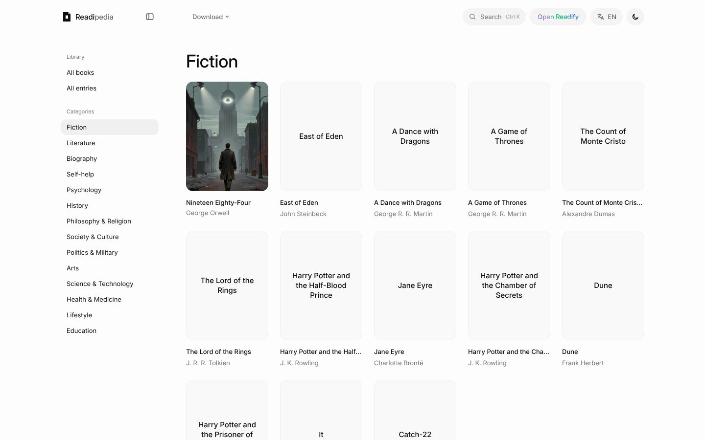

1. 可见标题 h1：分类名（36px）。
2. 书单网格（同 5.1，无筛选条）。
3. 分页，每页 48 本。

### 5.4 书籍概览 `#book`【必须】

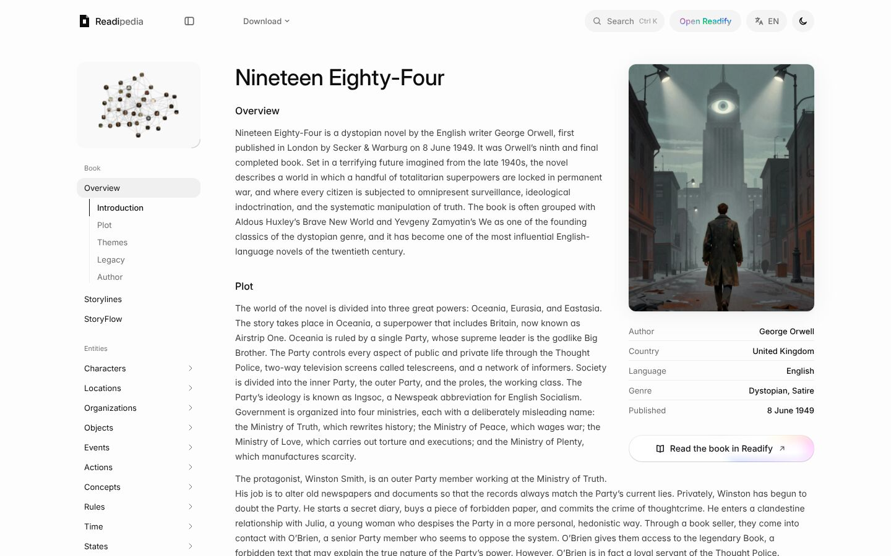

结构：

1. （仅手机）热门词条胶囊：连接数最多的 12 个词条，横向滚动，点击进入词条页。
2. 书名 h1「Nineteen Eighty-Four」：36px / 行高 42px / 字重 500（手机 28px / 34px）。
3. 信息栏：
   - 桌面：浮动在右侧，宽 `clamp(220px, 34%, 300px)`，正文绕排。宽度 ≥ 1024px 时上移到和书名顶部对齐。
   - 内容：封面（3:4，圆角 12px，带投影）→ 五行资料（Author / Country / Language / Genre / Published，每行 32px，左灰右黑，细线分隔）→「Read the book in Readify」按钮（见 6.6）。
   - 手机：不浮动，封面宽度占满（最高 60% 屏高，保证正文在首屏露头），资料和按钮在下面，按钮占满宽度。
4. 正文五节，每节 h2 为 16px 中粗：Overview → Plot → Themes → Background and Legacy → About the Author（作者节先有一行「George Orwell (Eric Arthur Blair, 1903 – 1950)」，再分 h3 小节）。
5. 页脚。

正文 14px / 行高 24px，颜色 `--text-body`；中文行高 1.85。

手机版：

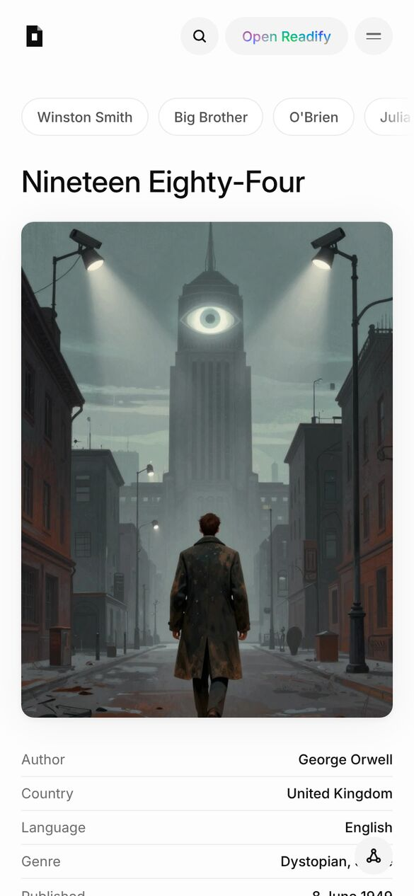

### 5.5 词条页 `#<entityId>`【必须】

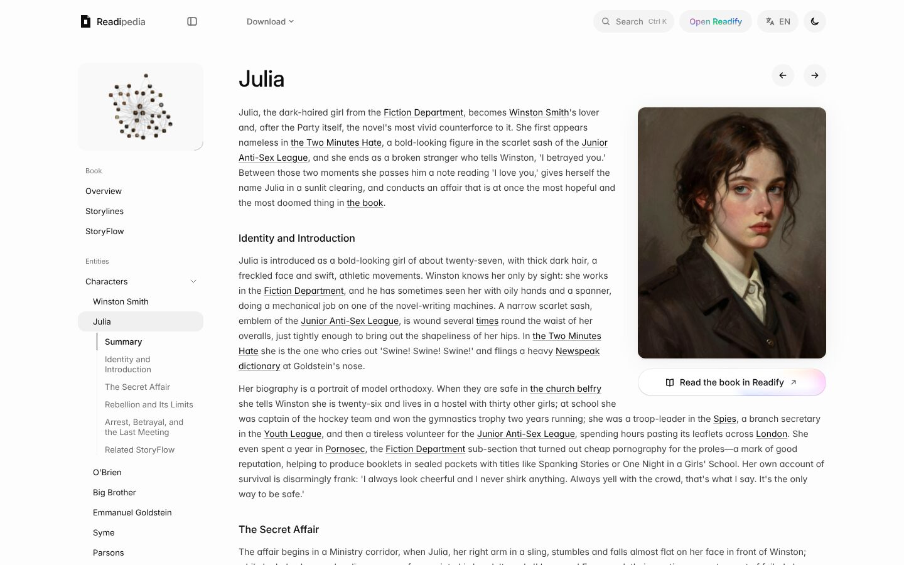

结构：

1. （仅手机）同类词条胶囊：同一类别所有词条横向排列，当前词条填灰并自动滚到中间；点击切换词条。手机上用它代替上一个 / 下一个箭头。
2. 标题行：词条名 h1；桌面右侧两个 36px 圆按钮「← →」，按侧边栏顺序切到上一个 / 下一个词条，到头时变灰不可点。
3. 信息栏（桌面浮动右侧，同书籍页宽度）：词条图（3:4，人物图偏上 20% 裁切）→「Read the book in Readify」按钮。手机还有一个「‹ Back to Nineteen Eighty-Four」返回链接（桌面侧边栏已有 Overview，所以桌面不显示）。没有图片的词条不显示图片，只留按钮。
4. 正文：Markdown 渲染。去掉原文的一级标题、「分类/标签」「源文件」引用行和分隔线；正文里出现的其他词条名自动变成链接（见 6.5）。
5. 「Related StoryFlow」：如果这个词条关联了本站有的 StoryFlow，正文末尾列出卡片（64px 方图 + 标题 + 两行描述），点击进入那条 StoryFlow。当前有 35 个词条会显示这一块。
6. 页脚。

中文模式下，如果某词条没有中文正文，顶部显示灰色提示「本词条暂无中文版，以下为英文原文。」，下面放英文。


### 5.6 故事线 `#view-storyline`、`#storyline/<index>`【必须】


一个「放映厅」页面，没有标题：

1. 大图区：圆角 24px（手机 20px）的场景图，高度 `100dvh - 68px - 140px`（最小 360px），图片铺满裁切。手机高度 `clamp(380px, 100dvh - 68px - 150px, 640px)`。
2. 图上叠字：底部黑色渐变，白字依次是日期（13px，70% 白）、标题（20px 中粗）、正文（14px / 24px，92% 白）。正文框最高占图片 58%（手机 56%），框内滚动、不显示滚动条；底部 24px 渐隐，往下滚后顶部 14px 也渐隐。
3. 缩略图条：89 张 96×54px、圆角 10px 的缩略图横向滚动；未选中 35% 不透明，悬停 75%，当前 100%。

交互：

- 点缩略图、键盘 ← →（首尾循环）、触屏在大图上左右滑动（水平 ≥ 40px 且明显大于垂直）切换场景。
- 切换时：当前缩略图滚到缩略图条中间；图片柔和交叉模糊替换；日期、标题、正文依次升起（7.3「文字依次出现」）；正文框回到顶部；地址改为 `#storyline/<index>`（替换，不新增历史）。
- 鼠标在大图上滚轮只滚正文，不滚页面。
- 缩略图悬停有 tooltip 显示场景标题（仅鼠标）。
- 中文模式用中文日期、标题、正文；中文正文如果以半句结束，末尾补「……」。

手机：

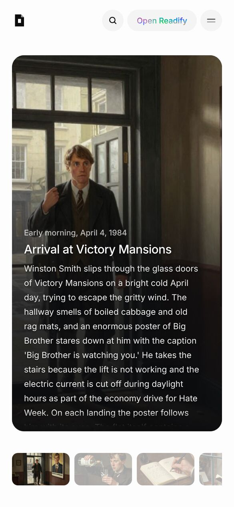

### 5.7 StoryFlow 列表 `#view-storyflow`【必须】

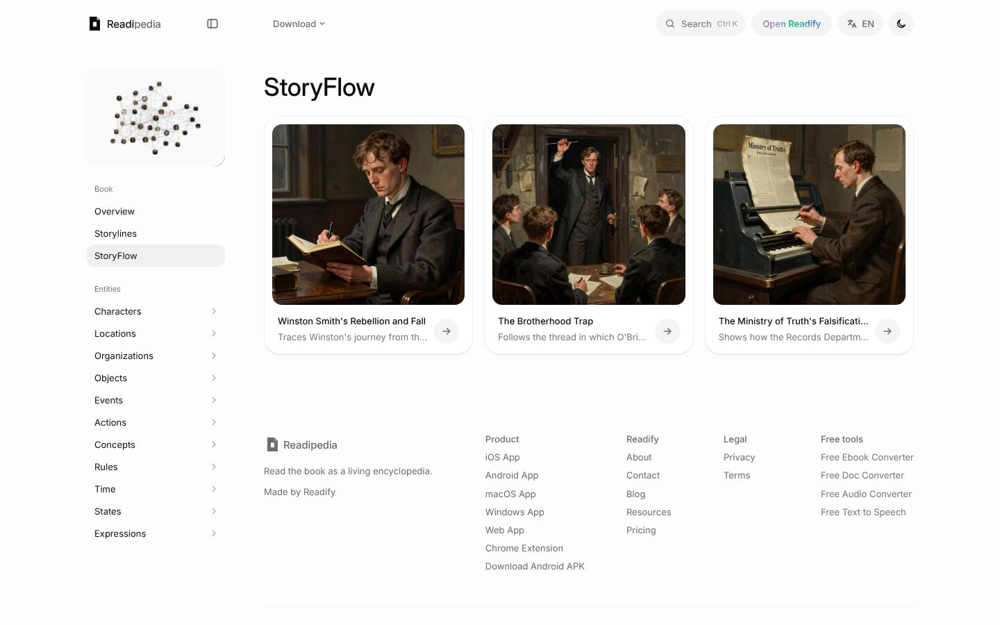

- 标题 h1「StoryFlow」。
- 三张 td 书库卡片（网格，每格最小 280px，间距 16px）：卡片高 344px、圆角 24px、白底细描边；内嵌 260px 高的图片台（圆角 14px）；底部标题和单行描述；右下 36px 圆形箭头按钮。悬停：卡片底色微变，图片放大到 1.02。
- 点卡片任意位置进入那条 StoryFlow。

### 5.8 单条 StoryFlow `#storyflow/<flowId>`【必须】

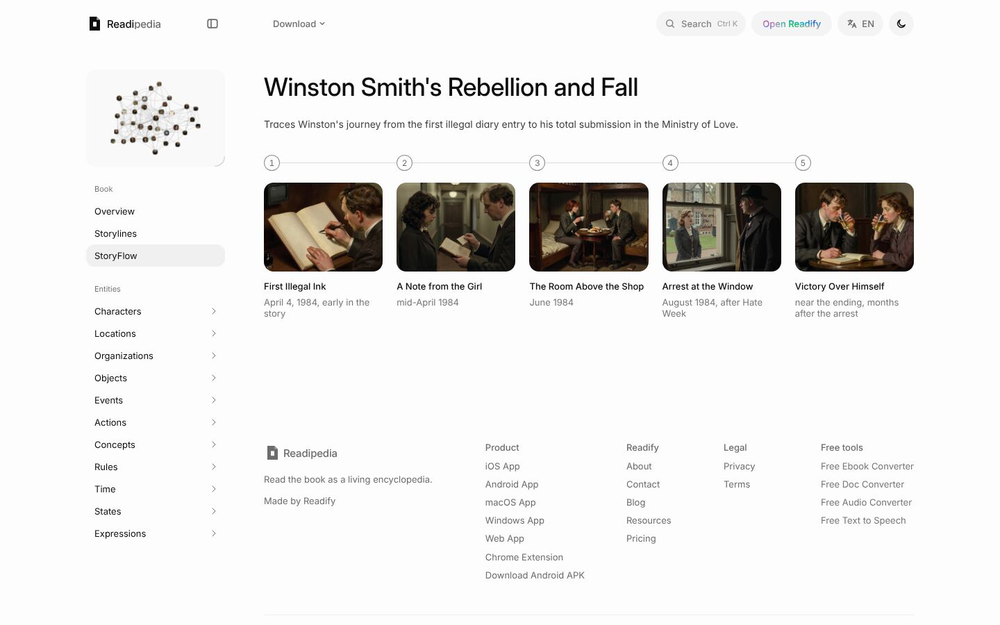

1. 标题 h1（StoryFlow 名）。
2. 导语：一段描述。中文模式下标题和描述用中文，下面加提示「本故事视角暂无中文版，以下为英文原文。」（节点正文只有英文）。
3. 五个节点按阅读顺序编号：
   - 桌面横排五列，顶部一条细线连起 1–5 号圆圈（23px 圆圈、12px 数字）。
   - 手机竖排，编号和细线在左侧。
   - 每个节点：图片（桌面 4:3，手机 16:10，圆角 14px）、节点标题、章节时间（灰）。不加卡片外框。
4. 点节点打开详情：

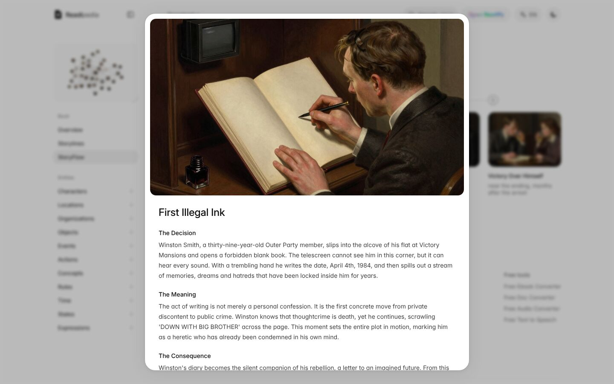

- **桌面**：居中弹层，宽 `min(760px, 100vw - 64px)`，圆角 24px，背景遮罩 + 3px 模糊。弹层从被点的那张图的位置和大小「长」出来（FLIP 动画，400ms），关闭时缩回原位（250ms）。内容：16:9 图片、标题（24px）、Markdown 正文（标题降一级显示）。只有内容区滚动，不显示滚动条。没有关闭按钮：点遮罩、按 Esc、浏览器返回都会关闭。打开时页面不能滚动。
- **手机**：底部抽屉，最高 84% 屏高，顶部有拖动把手。从底部滑上来；向下拖动关闭（从把手随时可拖，从正文要先滚到顶；拖过抽屉高度 25% 或快速下滑速度 > 0.5px/ms 就关闭，否则弹回），拖动时遮罩随距离变淡；点遮罩也关闭。

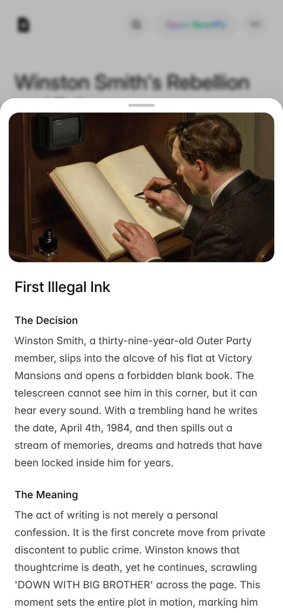

---

## 6. 全局功能

### 6.1 搜索【必须】

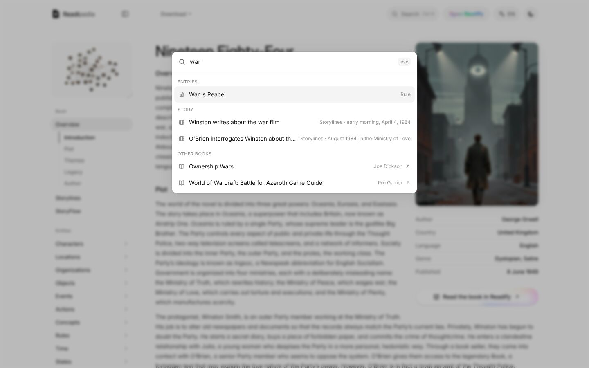

**打开方式**：点页头搜索按钮；Ctrl+K / ⌘K（再按一次关闭）；不在输入框时按「/」。

**面板**：距顶部 126px、宽 600px、圆角 14px；背景遮罩 + 3px 模糊。打开时面板从 0.96 缩放、2px 模糊恢复（250ms），关闭更快（150ms）。列表最高 340px。

**两种搜索范围**：

在书库页（全部书籍、全部词条、分类）时，搜索整个书库，占位文字「Search books and entries...」：

| 分组 | 无输入时 | 有输入时 |
|---|---|---|
| Pages | 不显示 | 书库页面（全部书籍、全部词条、各分类）+ 本书的 Storylines、StoryFlow |
| Books | 前 8 本 | 最多 40 本 |
| Entries | 前 8 条 | 最多 60 条（本书和外书交替） |
| Story | 不显示 | 场景、StoryFlow、StoryFlow 节点，最多 30 条 |

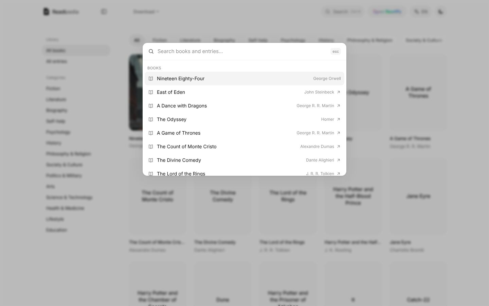

在书籍百科页时，**本书优先，其他书籍放在最后**，占位文字「Search entries and pages...」：

| 分组 | 无输入时 | 有输入时 |
|---|---|---|
| Pages | Overview / Storylines（89 scenes）/ StoryFlow（Three threads） | 同左，按输入过滤 |
| Entries | 侧边栏顺序前 12 个 | 最多 60 个 |
| Story | 不显示 | 场景、StoryFlow、StoryFlow 节点，最多 30 条 |
| Other books | 不显示 | 其他书（先书后词条），最多 20 条，带 ↗ 图标 |

**匹配规则**：

- 不区分大小写的包含匹配，同时查当前语言名称和另一种语言名称（所以中文界面输入英文也能搜到）。
- 书籍还匹配作者（中英文），但输入至少 2 个字才匹配作者，避免输一个字就列出所有书。
- 其他条目还会匹配右侧提示文字（如类别名、所属书名）。
- 每组内以输入开头的排前面，其余保持原顺序。

**每行**：左图标（页面、书、词条、场景、StoryFlow 各不同）、名称（单行省略）、右侧灰色提示（类别、作者、所属书、场景日期等）。外站链接在最右加 ↗。

**操作**：↑ ↓ 移动选中（首尾循环），回车打开，Esc 关闭；鼠标悬停即选中；点遮罩关闭。关闭后焦点回到打开前的元素。

**打开结果**：页面 → 进入对应页；书库页 → 打开该书库页；本书 → 书籍概览；场景 → 故事线定位到该场景；StoryFlow → 进入；StoryFlow 节点 → 进入并自动打开那个节点的弹层；词条 → 词条页；外站书和词条 → 新标签打开 readifyai.com。

**手机**：面板贴近顶部，高度跟随可视区域（`visualViewport`），不会被键盘挡住；输入框 16px 防止 iOS 放大；Esc 位置变成「Cancel」文字按钮（所有触屏设备都这样）。


### 6.2 语言【必须】

- 两种语言：英文、中文。首次访问按浏览器语言（`zh` 开头为中文），之后记在 `localStorage['readipedia-lang']`。
- 桌面：页头语言按钮打开下拉菜单（宽 240px，圆角 12px），英文、中文可选，日语、西班牙语、法语灰色不可选。菜单从按钮右上角长出来（缩放 0.97 → 1，250ms），关闭缩到 0.99 淡出（150ms）。点别处或 Esc 关闭。
- 手机：菜单里的「EN / 中文」两段切换。
- 切换后立即生效，不刷新：界面文字（用 `ZH_UI` 对照表替换，英文原文写在 HTML 里）、书籍正文、词条名、故事线、StoryFlow 标题、书库都换成对应语言；当前页面的标题、章节标题、正文做一次柔和交叉模糊（200ms）。
- 中文词条正文文件较大（780 KB），第一次切到中文时才加载，加载完自动刷新当前词条。
- `<html lang>` 同步为 `en` 或 `zh-CN`；中文模式正文行高放宽到 1.85，标题去掉字距。

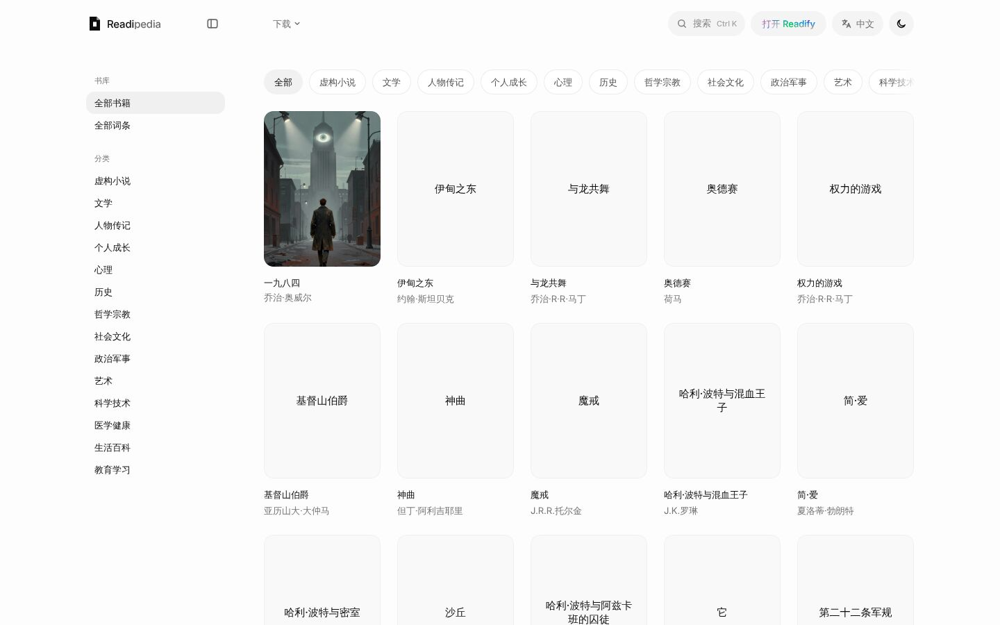

### 6.3 主题【必须】

- 三种偏好：浅色、深色、跟随系统（默认）。浅色或深色存在 `localStorage['readipedia-theme']`，跟随系统时删除这个键。
- 桌面页头按钮只在浅色和深色之间切换，并记住；手机菜单里有三段切换（含 System）。
- 跟随系统时，系统改深浅色会实时跟着变。
- 切换时整页（含图谱画布）用 View Transitions 一次交叉淡化（200ms）；按钮里月亮和太阳在同一位置交叉模糊替换（从 0.25 缩放出现，250ms）。
- `<head>` 的内联脚本先设好主题，首屏不会闪。

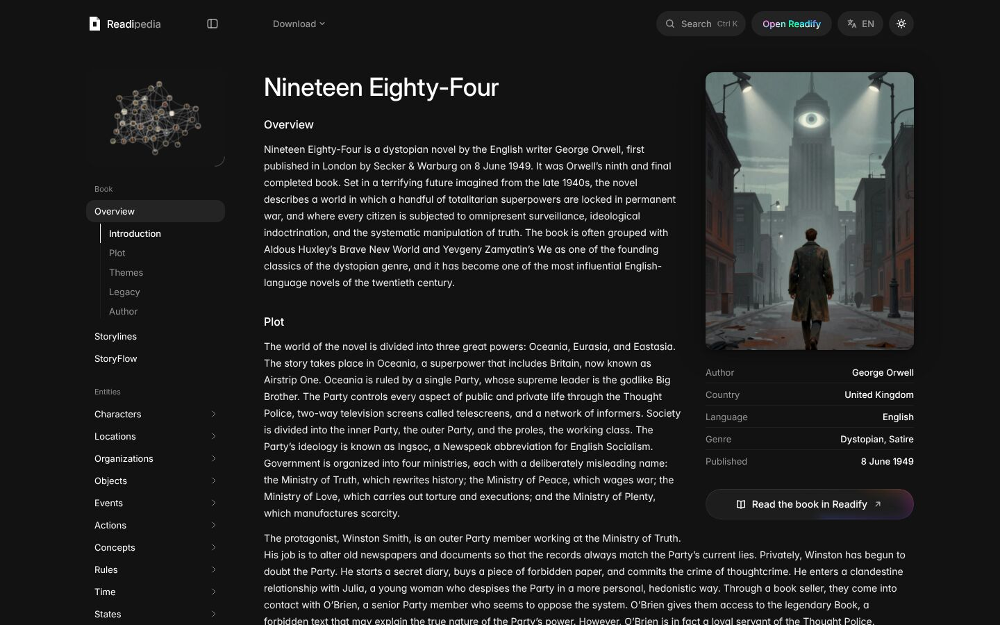

### 6.4 知识图谱【必须】

图谱只有一个画布实例，在小窗、展开窗、手机全屏之间移动和变形，不会重复创建。

**数据和布局**

- 两种视角：书籍概览、故事线、StoryFlow 页显示「总览图」；词条页显示「词条图」（当前词条 + 它的邻居）。
- 节点数量按屏幕面积算预算：桌面每 60×60px 一个节点，最多 96 个、边最多 288 条；手机每 76×76px 一个，最多 64 个、边最多 144 条。超出预算时，总览图按覆盖面最大、核心度最高的节点贪心选取；词条图优先选和当前词条邻居连接多的。
- 布局是确定的：同一个视角每次打开位置都一样（有缓存），不是每次随机。
- 换视角时，节点从旧位置平滑移动到新位置，新节点淡入，旧节点淡出（约 300ms）。

**节点和连线的画法**

- 节点是圆形头像（`assets/images/graph/` 的 256px 小图），没加载好之前是按类别着色的圆点（颜色见 8.6）。主节点稍大，其余按连接数在一个小范围内变大小。
- 深色模式下每个头像加一圈半透明白色细边，避免暗图融进背景。
- 连线为弧线（曲率 0.18），浅色模式黑色 12% 透明度，深色白色 28%；和悬停 / 选中节点相连的线加深（34% / 60%）并加粗到 1.5。

**桌面：侧边栏小窗**

- 200×140px，圆角 14px，灰底细描边。右下角一个细弧线标记（展开按钮），平时 35% 不透明，鼠标进小窗 75%，指到按钮上 100% 并放大 1.2 倍。
- 点标记展开。

**桌面：展开窗**

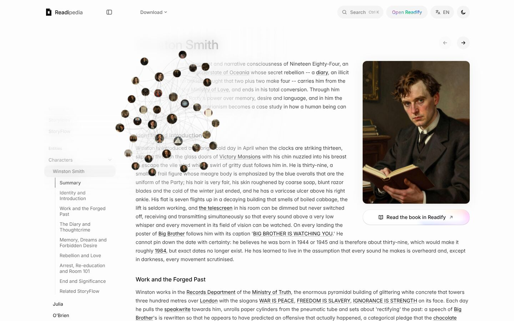

- 从小窗位置变形放大成浮在页面左上方的大窗：宽 `min(760px, 视口宽, max(420px, 48% 视口宽))`，高 `min(560px, 可用高, max(300px, 58% 可用高))`；背景是带 16px 模糊的半透明页面色，向右和向下渐隐，没有硬边框。
- 没有关闭按钮：点窗外任意处或按 Esc 收起。
- 悬停节点：显示名称 tooltip（自动保持在窗内），其他节点变淡到 65%，相关连线加深。
- 点节点：打开该词条页，图谱保持展开并切到该词条的视角。
- 拖动节点：节点跟手，松手后整张网像弹簧一样回到原位，相机不动。
- 可以拖动画布平移、滚轮缩放。点空白处取消选中并重新适配视野。
- 鼠标悬停正文里的词条链接时，图谱里对应节点也高亮。

**手机：菜单里的预览**

- 菜单顶部 160px 高的预览，不加底框。右下角一个 L 形控制标记。
- 点标记或在菜单顶部下拉，图谱展开成全屏。

**手机：浮动按钮和全屏图谱**

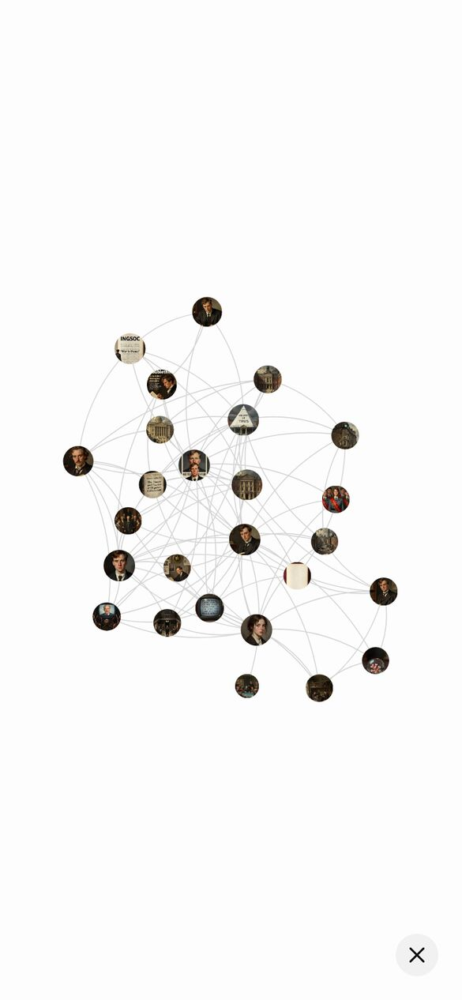

- 书籍页和词条页右下角有 36px 浮动按钮（图谱图标），距右下 20px + 安全区。书库、故事线、StoryFlow 页不显示。
- 点浮动按钮：从按钮位置展开成全屏图谱。在书籍页打开的是总览图，在词条页打开的是该词条视角。
- 全屏时右下角 L 形标记变形成 ✕（灰色圆底渐显），点击收起回原位置。
- 全屏图谱里可以拖动节点、平移、缩放。小窗预览里的点击不跳转（只是预览）。

**手机：图谱和词条连成一个空间（Continuum）**

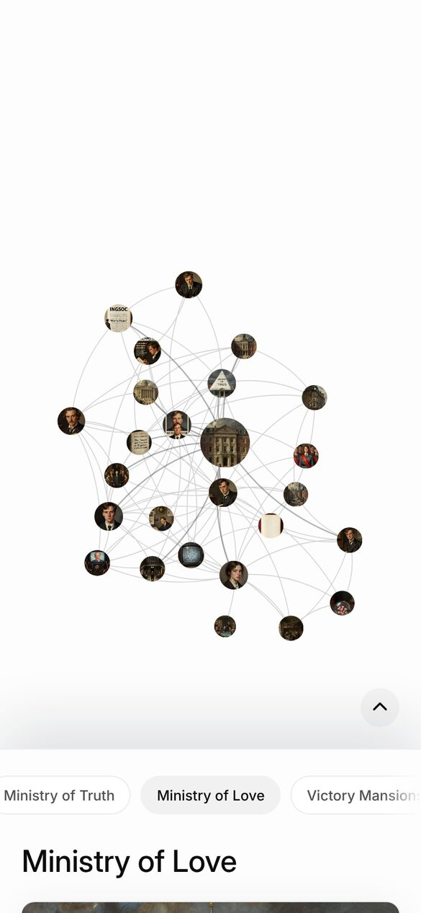

这是手机端最复杂的交互，正式版必须做，但可以分阶段：

1. 在全屏图谱里点一个节点：该节点放大（1.75 倍，240ms 弹性），相关连线加粗；屏幕底部升起该词条的文章，露出 `clamp(112px, 18dvh, 168px)` 高（横屏 104px），能看到同类词条胶囊和标题。
2. 手指在文章上往上推：文章跟手上升盖住图谱，图谱同时下移、缩小、变淡；文章接近顶部时页头渐显。松手按速度和位置判断落到「读文章」还是「看图谱」（速度 > 620px/s 视为甩动；打开超过 32% 即落到文章，关闭超过 68% 即落回图谱），用弹簧动画收尾。
3. 文章完全升起后就是普通的可滚动文章，和词条页一样有图片、Readify 按钮、正文、相关 StoryFlow。
4. 浮动按钮这时变成上下切换：在文章里点它回到图谱，在图谱里点它回到文章。
5. 在文章里点同类胶囊或正文里的词条链接：原地换文章，图谱同步把焦点移到那个节点。
6. 在文章状态下打开菜单，菜单盖在文章上；菜单里的图谱预览借用同一个画布，关闭菜单回到原阅读位置。
7. 横向滑动手势在这个空间里不打开菜单。

### 6.5 词条链接和悬停预览

**自动链接**【必须】：词条正文渲染后，把其他词条的名字替换成链接（英文按整词匹配、不区分大小写；中文直接匹配，至少 2 个字；英文至少 3 个字母；长名字优先）。标题、代码、已有链接、按钮里不替换；当前词条自己的名字不替换。链接样式：文字同色，淡下划线（30% 透明），悬停下划线变实。

**悬停预览**【可选】：

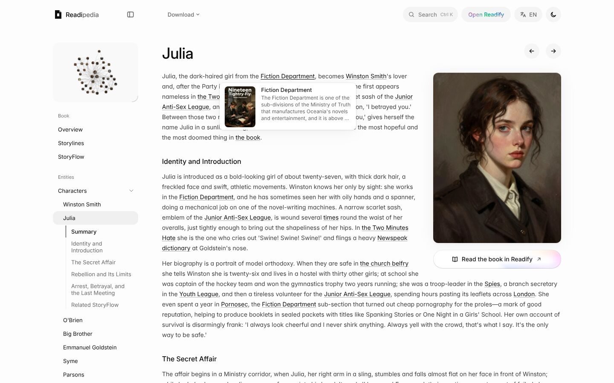

- 只在有鼠标的设备上生效。鼠标停在词条链接上 80ms 后出现一个 320px 宽的气泡：左边 72×96 小图，右边词条名和第一段超过 40 字的正文（最多 220 字，4 行）。
- 气泡放在链接下方 8px，放不下就放上方，左右离屏幕边至少 16px。
- 气泡打开时移到另一个链接，同一个气泡滑过去（160ms）并柔和替换内容，不会消失再出现。离开链接后等 80ms 才隐藏，给鼠标移到下一个链接留时间。
- 滚动、点击、Esc、窗口变化时立刻隐藏。键盘聚焦链接时也显示。

**点击**：进入词条页；在手机全屏图谱的文章里点，则原地换文章（见 6.4）。

### 6.6 Readify 引流入口

| 入口 | 位置 | 链接 | 优先级 |
|---|---|---|---|
| Read the book in Readify | 书籍页、词条页、手机图谱文章的信息栏 | app.readifyai.com，新标签 | 【必须】 |
| Open Readify | 页头右侧 | 按设备，见 6.7 | 【必须】 |
| Download 下拉菜单 | 页头左侧 | 各平台下载 | 【演示】 |
| Get Readify | 手机菜单顶部 | 同上 | 【演示】 |
| 页脚 Product 列 | 每页底部 | 各平台下载 | 【必须】 |
| 其他书籍、其他书的词条 | 书库、搜索 | readifyai.com 对应页面 | 【必须】 |
| 促销卡片 | 页面底部浮动 | 带 UTM 的 app.readifyai.com | 【演示】 |

**「Read the book in Readify」按钮**：

- 胶囊按钮，高 44px，圆角 22px，左书本图标、文字、右 ↗ 箭头。浅色模式白底深字，深色模式 #1d1d1d 底白字，都有细描边和轻投影。
- 外圈有一道彩色流光沿边框转（libraries.dev 的 border beam），让它成为页面上最显眼的操作【可选：流光】。
- 悬停：底色微变，箭头向右上移 2px 并变实。按下缩小到 0.97。
- 手机上按钮占满信息栏宽度。

### 6.7 下载菜单和设备识别【演示】

- 下拉面板宽 600px，圆角 16px：左边两列应用列表，按 Desktop（macOS、Windows）、Mobile（iOS、Android）、Browser（Extension、Web app）分组，每项是 32px 图标方块 + 名称 + 一行说明；右边一个灰色区块放二维码（120px）和「On your phone? / Scan to get Readify for iOS or Android.」。
- 打开动效同语言菜单，从左上角长出。按钮和面板之间有一条看不见的「桥」，鼠标移过去不会关闭。
- 根据 User Agent 识别设备（iOS、Android、Mac、Windows）：对应项的图标和说明变蓝，说明改为「This device」；手机菜单里对应项加蓝色「This device」标签。
- 页头「Open Readify」按钮：如果识别出设备且该平台有下载链接，文案改为「Download for Mac」「Download for Windows」或「Get the app」，图标换成该平台标志；否则显示「Open Readify」链到网页版，不带图标。
- 链接配置在 `app.js` 的 `READIFY_APPS`：iOS、Android、Chrome 扩展、网页版有链接，**macOS 和 Windows 为空**，这两项会显示但点击无效（`aria-disabled`），所以 Mac 和 Windows 用户目前看到的仍是「Open Readify」。
- 「Open Readify」的文字是 td 的 Pro 渐变文字效果（七层径向渐变叠在灰色底字上，`pro-gradient-text.css`），按钮本身是灰色胶囊。

### 6.8 促销卡片【演示】

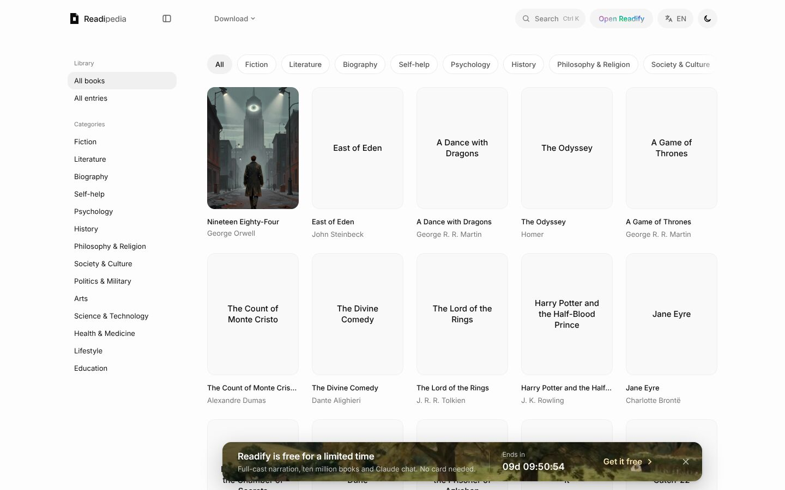

一张浮在页面底部的彩画卡片，用于「Readify 限时免费」活动：

- **何时出现**：页面滚过 35% 或滚过 1.5 屏（取先到者），或标签页在前台累计停留 8 秒。页面不够一屏长时只等计时。
- **出现动效**：td Toast，从下方 16px、缩放 0.97、模糊 2px 升起（350ms）。
- **布局**：
  - 桌面：宽 `min(880px, 正文区宽)`，在正文区（不是整个窗口）水平居中，跟着侧边栏收起展开移动；距底部 16px；圆角 16px。左边标题（17px 粗）和副标题，一条竖线，倒计时（「Ends in」+ `09d 09:50:54`），右边 CTA（暖黄色文字 + 箭头）和关闭 ✕。
  - 769–1100px 和手机：两行紧凑版，去掉副标题和竖线，标题用短版本。手机左右各留 20px。
  - 手机上打开菜单、全屏图谱或图谱文章时，卡片隐藏让位。
- **5 个 A/B 文案**（voices、library、claude、import、all），每个读者随机分到一个并记在 `localStorage['readipedia-promo-variant']`，每个版本有自己的背景画（`assets/brand/promo-*.jpg`）。文案中英各一套。
- **倒计时**：每秒更新，截止时间在 `index.html` 的 `data-end="2026-10-31T23:59:59+08:00"`。只有变化的数字做 td「数字弹入」动画（从下方 8px 带模糊弹入，500ms，多个数字同时变时依次延后 70ms）。过期后倒计时和竖线隐藏，卡片保留。
- **CTA**：链接自动加 `utm_source=readipedia&utm_medium=promo-card&utm_campaign=free-2026&utm_content=<版本>`。
- **关闭**：点 ✕，卡片下沉淡出（250ms）后从页面移除，刷新后会再出现。
- **埋点**：出现、点击、关闭三个事件，推到 `window.dataLayer`（`promo_view` / `promo_click` / `promo_close`，带 `promo_variant`），同时派发 `readipedia:promo` 自定义事件。
- 卡片完全独立于页面布局：固定定位，不占位置，不改页面任何 class 或变量。
- 预览参数 `?promo=<版本>` 本意是强制显示指定版本，但目前会被路由抹掉，见第 11 节。

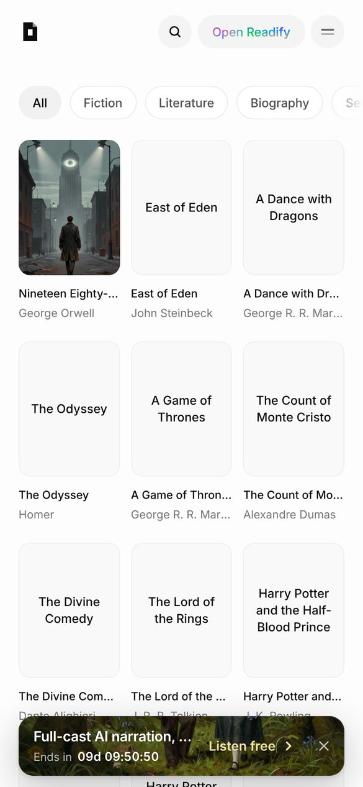

### 6.9 Tooltip【可选】

- 带 `data-tooltip` 的元素（侧边栏收起按钮、故事线缩略图）在鼠标悬停 80ms 后显示一个小气泡（12px 字，圆角 8px）。
- 优先显示在上方 8px，放不下放下方。
- 在相邻的 tooltip 元素之间移动时，同一个气泡滑过去并改变宽度（160ms），不闪烁。
- 只对鼠标生效，键盘聚焦（`:focus-visible`）也显示。滚动或按下时隐藏。触屏设备不显示。

### 6.10 阅读位置

- 【必须】刷新后回到地址对应的页面（滚动位置不恢复，从页面顶部开始）。
- 【可选】宽度变化时保持阅读位置：记下页头下方那一行是哪个段落、读到段落的百分之几；宽度变化（折叠屏开合、旋转、调整窗口）后在 0、120、400、700ms 几次把那一行放回原位置。只有高度变化（手机地址栏收起）时不处理。图谱展开或菜单打开时不处理。

### 6.11 键盘和手势汇总

| 操作 | 效果 |
|---|---|
| Ctrl/⌘ + K | 打开 / 关闭搜索 |
| / | 打开搜索（不在输入框时） |
| ↑ ↓ / Enter / Esc | 搜索里移动、打开、关闭 |
| ← → | 故事线页切换场景 |
| Esc | 关闭搜索、语言菜单、下载菜单、展开的图谱、StoryFlow 弹层、悬停预览 |
| Tab | 跳过链接「Skip to content」在第一个 Tab 时出现 |
| 手机：从左往右滑 | 打开菜单 |
| 手机：菜单上从右往左滑 | 关闭菜单 |
| 手机：菜单顶部下拉 | 展开全屏图谱 |
| 触屏：故事线大图左右滑 | 切换场景 |
| 手机：StoryFlow 抽屉下拉 | 关闭 |
| 手机：图谱文章上推 / 下拉 | 在图谱和文章之间切换 |

---

## 7. 动效与交互规范

### 7.1 原则

- 所有动效照 td 的组件做，数值来自 `style.css` 的 `:root` 动效 token。JS 里的动画也从 CSS 读这些 token（`motion.ms('--duration-slow')` 等），保证 CSS 和 JS 节奏一致。
- 打开慢、关闭快。
- 每个动效都要在「减少动态效果」下关掉（7.4）。

### 7.2 基础 token

| Token | 值 | Token | 值 |
|---|---|---|---|
| `--duration-stagger` | 40ms | `--ease-smooth-out` | `cubic-bezier(0.22, 1, 0.36, 1)` |
| `--duration-micro` | 80ms | `--ease-in-out` | `ease-in-out` |
| `--duration-quick` | 150ms | `--ease-out` | `ease-out` |
| `--duration-fast` | 250ms | `--ease-bounce` | `cubic-bezier(0.34, 1.36, 0.64, 1)` |
| `--duration-medium` | 350ms | `--ease-bounce-strong` | `cubic-bezier(0.34, 3.85, 0.64, 1)` |
| `--duration-slow` | 400ms | `--distance-micro / small / base / medium / large` | 4 / 6 / 8 / 12 / 30px |
| `--duration-very-slow` | 500ms | `--scale-large / medium / small / tiny` | 0.96 / 0.97 / 0.98 / 0.99 |
| | | `--blur-small / medium / large` | 2 / 3 / 8px |

悬停和按下反馈统一用 `--motion-hover: 150ms ease-out`。

### 7.3 组件动效

| 名称（td 组件） | 用在哪里 | 参数 |
|---|---|---|
| 页面进场（Page side-by-side） | 每次换页 | 新页从右 8px、模糊 3px 滑入并淡入，250ms，smooth-out；旧页立刻消失，不等待 |
| 文字依次出现（Texts reveal） | 书库书卡和词条、故事线日期标题正文、书库换页时的标题 | 从下方 12px、模糊 3px 升起，500ms，间隔 40ms |
| 柔和替换（Text swap soft） | 切语言、故事线换图、悬停预览换内容、切主题 | 交叉模糊 2px 淡入，200ms，ease-in-out |
| 下拉菜单（Menu dropdown） | 语言菜单、下载菜单 | 开：从 0.97 缩放到 1，250ms；关：缩到 0.99 淡出，150ms；从触发按钮那一角长出 |
| 面板（Panel reveal） | 桌面侧边栏收起展开、手机菜单 | 开 400ms，关 350ms，模糊 2px，smooth-out |
| 弹窗（Modal） | 搜索面板、StoryFlow 弹层 | 开 250ms（弹层 400ms），关 150ms；面板从 0.96 + 2px 模糊恢复 |
| 折叠面板（Accordion） | 侧边栏词条类别 | 高度 + 2px 模糊 + 透明度，开关各 250ms；箭头同步旋转 |
| 滑动指示条（Tabs） | 目录竖线指示条、故事线缩略图下划线（当前故事线页隐藏） | 250ms，smooth-out |
| Tooltip | data-tooltip、悬停预览 | 延迟 80ms 后 150ms 出现（从 0.98 缩放），50ms 消失；相邻元素间滑动 160ms |
| Toast | 回到顶部按钮、促销卡片 | 从下方 16px + 0.97 缩放 + 2px 模糊，进 350ms，出 250ms |
| 图标替换（Icon swap） | 主题按钮月亮/太阳 | 从 0.25 缩放 + 2px 模糊，250ms |
| 骨架屏 + 图片显现（Skeleton / Reveal） | 所有大图 | 图片未加载时容器灰底脉动一次（1000ms，透明度 1 → 0.5 → 1）；加载完图片从 2px 模糊淡入（400ms）；已在缓存里的图直接显示 |
| Learn more 箭头 | 促销 CTA 箭头、手机「Back to」链接 | 悬停时箭头向阅读方向移 2px，两臂张开 8°，350ms |
| 数字弹入（Number pop-in） | 促销倒计时 | 见 6.8 |
| 菜单按钮 | 手机菜单按钮 | 两线滑到中间再旋转成 ✕，300ms |
| 卡片尺寸（Card resize） | 图谱视角切换 | 300ms |

图谱自己的动效（不随 token 走，只在减少动态效果时归零）：小窗和展开窗互相变形 420ms（smoothstep）；手机从小窗展开 180ms；手机选中节点聚焦 240ms（弹性曲线）；拖动节点松手后的弹簧（刚度 140 / 55，阻尼 22）；手机图谱文章的弹簧收尾（频率 14）。

### 7.4 减少动态效果

系统开启「减少动态效果」（`prefers-reduced-motion: reduce`）时：

- 所有时长 token 变成 0，所有 CSS 和 JS 动效（包括图谱动画、主题交叉淡化、书库出现动效）直接到最终状态。
- 页面滚动从平滑改为直接跳。
- 骨架屏不脉动，按钮按下不缩放，Logo 不翻角。

### 7.5 低配设备降级（lite 模式）【可选】

只针对确实卡的设备：

- 只在 Readify 按钮的流光正在屏幕上播放时测帧率（这时屏幕在全速刷新），页面打开 2 秒后开始。
- 每次采样 2 秒或 60 帧，取帧间隔中位数；**连续两次**中位数都超过 40ms（约低于 25fps）才判定为卡。中间有一次正常就重新计数。不看硬件参数，不看静止时的帧率，也不看加载时偶发的长帧。
- 判定后给 `<html>` 加 `is-lite`，并且之后不再检测：流光停住（保持一个固定角度的高亮），「Open Readify」渐变文字停住并调亮，搜索遮罩去掉背景模糊。

---

## 8. 设计 token

所有 token 定义在 `style.css` 开头的 `:root`，深色值在 `[data-theme="dark"]`。

### 8.1 颜色

| Token | 浅色 | 深色 | 用途 |
|---|---|---|---|
| `--bg-page` | #fdfdfd | #121212 | 页面底色、页头、侧边栏 |
| `--bg-surface` | #ffffff | #181818 | 浮层表面 |
| `--bg-subtle` | #f9f9f9 | #181818 | 次级背景 |
| `--bg-hover` | #f4f4f4 | #232323 | 灰色按钮底、悬停 |
| `--bg-hover-strong` | #f1f1f1 | #2a2a2a | 灰色按钮悬停 |
| `--bg-pressed` | #eae9e9 | #262626 | 按下 |
| `--text-primary` | #0d0d0d | #ffffff | 标题、主要文字 |
| `--text-body` | #3f3f3f | #ededed | 正文 |
| `--text-secondary` | #6c6c6c | rgba(202,202,202,.7) | 次要文字 |
| `--text-label` | #767676 | #8a8a8a | 分组标题、作者、提示 |
| `--text-muted` | #8f8f8f | #8f8f8f | 最弱文字、图标 |
| `--accent` | #0073e5 | #55cfff | 焦点框 |
| `--brand-blue` | #0053e3 | #7cd4ff | 「This device」等品牌蓝 |
| `--stage-bg` | #f9f9f9 | #131313 | 灰色展示台（文字封面、图谱小窗、图片底） |
| `--card-bg` | #ffffff | #181818 | 卡片 |
| `--hover-bg` / `--active-bg` | 黑 3% / 5% | 白 5% / 8% | 侧边栏行悬停、当前 |
| `--link-decoration` | 黑 30% | 白 30% | 链接下划线 |
| `--border-hairline` | 黑 6% | 白 6% | 细分隔线 |
| `--tt-bg` / `--tt-fg` | #ffffff / #1b1b1b | #202020 / #fbfbfb | 菜单、tooltip、搜索面板、下载面板 |
| `--overlay-bg` | rgba(15,15,15,.28) | rgba(0,0,0,.5) | 弹窗遮罩 |

阴影：

- `--media-shadow`（大图）：`0 -1px 0 rgba(0,0,0,.06), 0 2px 6px rgba(0,0,0,.05), 0 4px 42px rgba(0,0,0,.06)`
- `--tt-shadow`（浮层）：`0 0 0 1px rgba(0,0,0,.06), 0 2px 6px rgba(0,0,0,.05), 0 4px 42px rgba(0,0,0,.06)`
- `--modal-shadow`（搜索、弹层）：`0 0 0 1px rgba(0,0,0,.06), 0 4px 42px rgba(0,0,0,.08), 0 2px 6px rgba(0,0,0,.06)`
- 深色模式的阴影更深并加白色内描边，具体值见 `style.css`。

### 8.2 字体和字号

- 字体：Inter（可变字体，自托管），中文回退 PingFang SC、Hiragino Sans GB、Microsoft YaHei、Noto Sans CJK SC。代码字体 Roboto Mono / 系统等宽。
- 字重只用 400 和 500（促销卡片标题 600）。

| 用途 | 桌面 | 手机 |
|---|---|---|
| 页面标题 h1 | 36px / 42px，字距 -0.18px | 28px / 34px |
| StoryFlow 弹层标题 | 24px / 32px | 20px / 28px |
| 故事线场景标题 | 20px / 24px | 同 |
| 正文章节标题 h2 | 16px / 24px | 同 |
| 小节标题 h3 | 14px / 24px | 同 |
| 正文 | 14px / 24px（中文行高 1.85） | 同 |
| 界面文字（按钮、侧边栏、卡片标题） | 13px / 16px | 侧边栏放大，见 4.5 |
| 小字（提示、作者、tooltip） | 12px | 同 |
| 分组标题 | 11px / 14px | 13px |
| Logo 文字 | 15px，字距 -0.15px | 不显示 |

### 8.3 尺寸、间距、圆角

| Token | 值 |
|---|---|
| `--header-h` | 68px |
| `--page-max` | 1192px |
| `--sidebar-w` | 200px |
| `--sidebar-gap` | 56px（769–960px 为 32px） |
| `--prose-w` | 686px |
| `--m-gutter`（手机左右边距） | 20px |
| `--radius-sm / md / lg / pill` | 4 / 8 / 12 / 50px |
| 大图展示台、卡片、故事线大图、StoryFlow 弹层 | 24px（手机 20px） |
| 封面、图谱小窗、卡片内图片台 | 14px |
| 按钮高度 | 36px（圆按钮和胶囊）；Readify 按钮 44px |
| 侧边栏行高 | 32px（手机 44 / 40px） |

### 8.4 图标

- 16px 网格、1.5px 线宽、圆头圆角，在 14–18px 大小下清晰。常用图标在 `app.js` 的 `UI_ICONS` 里自绘：search、x、menu、chevron 系列、arrow 系列、sun、moon、languages、globe、book-open、network、film、route、grid、shapes 等。
- 平台标志（Apple、Windows、App Store、Android、Chrome、Discord、X、Instagram、YouTube）来自 Simple Icons（CC0），Windows 标志自绘。
- Logo：一张右上角折起的书页，中间开一个方窗，`viewBox 0 0 300 400`；折角用 #9a9aa0。

### 8.5 筛选胶囊（td 书库筛选）

全站所有筛选和胶囊行（书库筛选、手机词条胶囊、手机书籍热门胶囊）共用 `.td-filters` / `.td-filter`：

- 高 36px，左右内边距 15px，圆角 48px，13px 中粗字。
- 浅色：白底 + 1px 黑 8% 内描边，字 rgba(38,38,38,.8)；悬停 #f7f7f7；当前 #f1f1f1 底、#080808 字、无描边。
- 深色：白 4% 底 + 白 8% 内描边；悬停白 8%；当前白 14% 底、#fbfbfb 字。
- 间距 9px，一行排列，超出横向滚动，滚动条隐藏，最后一个右边多留 36px。

分页器的页码按钮用同一套样式（最小宽 36px），两端是 36px 圆形箭头按钮，到头时 40% 透明不可点。

### 8.6 图谱类别颜色

图谱节点在头像加载前的圆点颜色：

| 类别 | 浅色 | 深色 |
|---|---|---|
| Characters | #e11d48 | #fb7185 |
| Locations | #059669 | #34d399 |
| Organizations | #4f46e5 | #818cf8 |
| Concepts | #7c3aed | #a78bfa |
| Rules | #ea580c | #fb923c |
| Objects | #d97706 | #fbbf24 |
| Events | #0284c7 | #38bdf8 |
| Actions | #2563eb | #60a5fa |
| Creatures | #9333ea | #c084fc |
| States | #0d9488 | #2dd4bf |
| Expressions | #db2777 | #f472b6 |
| Time | #64748b | #94a3b8 |

---

## 9. 数据结构

运行时只加载 `data/` 下这 6 个 JS 文件，它们把数据挂在 `window` 上。

### 9.1 `window.WIKI_STORE`（`data/wiki_store.js`）

```js
WIKI_STORE = {
  master: {
    book: {
      id: 'book-doc-books-001-1984-4b9fbb7c4955',
      title: 'Nineteen Eighty-Four', title_zh: '一九八四',
      author: 'George Orwell', published_year: 1949,
      cover_image, local_cover_image, read_url: 'https://app.readifyai.com',
      source_url: 'https://readifyai.com/books/Nineteen%20Eighty-Four'
    },
    author: { name, real_name, birth, death, sections: [{ title, content }] },
    article: {
      overview:              { content },          // 一段 HTML 文本
      plot:                  { title, paragraphs: [] },
      themes:                { content },
      background_and_legacy: { title, paragraphs: [] }
    },
    knowledge_graph: {
      all_nodes: {                                  // 149 个，key 为 id
        '<id>': {
          id: 'character-recall-character-julia-dd9a6077f139',
          type: 'Characters',                       // 12 种类别之一，复数英文
          label: 'Julia',                           // 英文名，也是正文、图片的查找键
          targets: ['<id>', …],                     // 出边
          imageUrl: '/wiki-file/…'                  // 原站路径；本地用文件名映射到 assets/images/graph/
        }
      },
      all_edges: [{ source, target, sourceLabel, type }],  // 2204 条，有向，前端按无向去重
      categories: [{ name, id, count }],
      subgraphs: { '<类别>': … }                    // 旧格式兼容，现在不用
    },
    storylines: [                                   // 89 个
      { index: 1, date: 'early morning, April 4, 1984', title, description, image_url, local_image }
    ],
    storyflows: [                                   // 3 个，列表用
      { id, title, description, image, local_image, link }
    ]
  },
  articles: { '<英文 label 或 id>': '<Markdown 正文>' },   // 304 个键（label 和 id 各一份）
  images:   { '<英文 label 或 id>': './assets/images/xxx.jpg' }
}
```

词条 id 的格式是 `<类型>-recall-<类型>-<slug>-<12 位哈希>`。

### 9.2 `window.WIKI_STORE_ZH`（`data/wiki_store_zh.js`）

```js
{
  book:   { title, author, sections: [{ title, paragraphs: [] }] },  // 顺序：概览、情节、主题、背景与影响
  author: { sections: [{ title, paragraphs: [] }] },
  storylines: [{ index, date, title, description }],                  // 按 index 对应英文
  storyflows: { '<flowId>': { title, description } },
  graph_labels: { '<entityId>': '温斯顿·史密斯' },                     // 词条中文名
  category_names: { character: '人物', location: '地点', … },          // 单数小写键
  graph_labels_source: …
}
```

### 9.3 `window.WIKI_ARTICLES_ZH`（`data/wiki_articles_zh.js`，按需加载）

`{ '<entityId>': '<中文 Markdown 正文>' }`，149 个。

### 9.4 `window.STORYFLOWS_COMPLETE`（`data/storyflows_complete.js`）

```js
[{
  id, title, description, cover,
  nodes: [                                   // 每条 5 个，按阅读顺序
    { title: 'First Illegal Ink', chapter: 'April 4, 1984, early in the story',
      level: 80, image: './assets/images/flow-node-….jpg',
      detail: '# The First Illegal Ink\\\n\\\n## The Decision …' }   // Markdown，换行被转义成 "\" + 换行，渲染前还原
  ]
}]
```

### 9.5 `window.ENTITY_STORYFLOWS`（`data/entity_storyflows.js`）

`{ '<英文 label>': ['<flowId>', …] }`，100 个词条。它照抄 Readify 每个词条页列出的 StoryFlow，其中很多 flowId 本站没有（本站只有 3 条），前端会过滤掉，所以只有 35 个词条显示「Related StoryFlow」。

### 9.6 `window.READIPEDIA_LIBRARY`（`data/library.js`）

```js
{
  local: {                                   // 本站完整收录的书
    id: '1984', category: 'fiction', year: 1949, cover,
    zh: { title: '一九八四', author: '乔治·奥威尔' },
    en: { title: 'Nineteen Eighty-Four', author: 'George Orwell' }
  },
  popular: ['伊甸之东', '与龙共舞', …],       // 14 个 slug，书库首屏顺序
  categories: [{ id: 'fiction', zh: '虚构小说', en: 'Fiction' }, …],   // 16 个，Readify 原顺序
  books: [                                   // 67 本
    { slug: '伊甸之东', cat: 'fiction',
      zh: ['伊甸之东', '约翰·斯坦贝克', '副标题（可选）'],
      en: ['East of Eden', 'John Steinbeck', 'Subtitle (optional)'] }
  ],
  entries: [                                 // 其他书的词条样例，9 条
    { book: '伊甸之东', type: 'character',
      zh: ['查尔斯·特拉斯克', '中文简介'], en: ['Charles Trask', 'English summary'] }
  ]
}
```

`slug` 是 Readify 网址里用的中文书名。分类 id：fiction、literature、biography、business、self-help、psychology、history、philosophy、society、politics、arts、science、computing、health、lifestyle、education（business 和 computing 目前没有书，不出页面）。

### 9.7 图片

| 文件名前缀 | 内容 | 数量 |
|---|---|---|
| `book-doc-…-cover.jpg` | 书封面 | 1 |
| `character- / location- / organization- / object- / event- / action- / concept- / rule- / time- / state- / expression- / creature-` | 词条配图 | 149 |
| `event-timeline-doc-books-001-1984-<n>-…-timeline.jpg` | 故事线场景图 | 89 |
| `story-flow-doc-books-001-1984-<n>-….jpg` | StoryFlow 封面 | 15（列表用 3） |
| `flow-node-…` | StoryFlow 节点图 | 15 |
| `graph/*.jpg` | 图谱 256px 头像 | 149 |

### 9.8 浏览器存储

| 键 | 值 | 说明 |
|---|---|---|
| `readipedia-theme` | `light` / `dark`，不存在表示跟随系统 | |
| `readipedia-lang` | `en` / `zh` | |
| `readipedia-promo-variant` | `voices` / `library` / `claude` / `import` / `all` | A/B 分组，固定不变 |

所有读写都包在 try/catch 里，存储被禁用时也能正常运行。

### 9.9 前端事件和全局接口

自定义事件（`document` 上派发）：

| 事件 | detail | 何时 |
|---|---|---|
| `readipedia:library` | `{ category, inPlace }` | 打开书库页 |
| `readipedia:lang` | 无 | 语言切换后 |
| `readipedia:scene` | `{ pos, index }` | 故事线换场景 |
| `readipedia:entity` | `{ id, label }` | 词条页渲染完 |
| `readipedia:promo` | `{ campaign, variant, action }` | 促销卡片 view / click / close |

模块间接口：`window.ReadipediaNav`（打开书库、书、词条；库路径）、`window.ReadipediaBridge`（story.js 用的换场景、显示视图、写历史）、`window.ReadipediaLibrary.searchItems()`、`window.StoryPages`（路由、打开场景和 StoryFlow、搜索条目）、`window.ReadipediaMedia.reveal()`（图片显现）。

---

## 10. 后端接口建议

原型把所有数据打包进前端，首页就要下载约 2 MB 的数据文件。正式版要支持上千万本书，建议改成下面的结构。

### 10.1 数据模型

```
Book          id, slug, title{zh,en}, subtitle{zh,en}, author{zh,en}, category_id,
              cover_url, published_at, country, language, genre, read_url,
              has_wiki(bool), popularity(数值，用于排序)
Category      id, name{zh,en}, order
BookSection   book_id, key(overview|plot|themes|background|author), lang, title, body(HTML/Markdown), order
Entity        id, book_id, type(character|location|…|creature), name{zh,en},
              image_url, thumb_url(256px), popularity(建议用真实浏览量，原型用连接数代替)
EntityArticle entity_id, lang, markdown, updated_at
EntityEdge    source_id, target_id                    (有向；前端按无向使用)
StorylineScene book_id, index, date{zh,en}, title{zh,en}, description{zh,en}, image_url
StoryFlow     id, book_id, title{zh,en}, description{zh,en}, cover_url, order
StoryFlowNode flow_id, order, title, chapter, image_url, markdown{en,zh?}
EntityStoryFlow entity_id, flow_id
```

原则：原文按原样存，不在服务端改写或摘要（设计原则第 5 条）；多语言字段缺失时前端显示英文并提示。

### 10.2 接口

| 接口 | 返回 | 对应页面 |
|---|---|---|
| `GET /api/library/books?category=&page=&per=48&lang=` | 书单（id、slug、书名、作者、封面、是否有百科、外链）、总数 | 全部书籍、分类 |
| `GET /api/library/categories?lang=` | 有书的分类和数量 | 书库侧边栏、筛选 |
| `GET /api/library/entries?type=&page=&per=180&lang=` | 跨书词条（名称、所属书、链接），已按热门和交替规则排好 | 全部词条 |
| `GET /api/books/{bookId}?lang=` | 书籍信息、资料栏、正文各节、作者 | 书籍概览 |
| `GET /api/books/{bookId}/entities?lang=` | 词条列表（id、类型、名称、缩略图、热门度），按类型分组 | 侧边栏、手机胶囊、上一个 / 下一个 |
| `GET /api/books/{bookId}/entities/{entityId}?lang=` | 正文 Markdown（缺译时带 `fallback: 'en'`）、图片、相关 StoryFlow、同类词条 | 词条页、悬停预览、手机图谱文章 |
| `GET /api/books/{bookId}/entities/{entityId}/preview?lang=` | 名称、小图、≤220 字摘要 | 悬停预览（轻量） |
| `GET /api/books/{bookId}/graph?view=overview\|entity&root=&nodeCap=&edgeCap=` | 节点和边；建议服务端完成选点，可附带预计算的坐标 | 知识图谱 |
| `GET /api/books/{bookId}/storylines?lang=` | 场景列表（缩略信息），正文可按需取 | 故事线 |
| `GET /api/books/{bookId}/storyflows?lang=`、`GET /api/storyflows/{flowId}?lang=` | 列表、节点详情 | StoryFlow |
| `GET /api/search?q=&lang=&book=&limit=` | 分组结果，见 10.3 | 搜索 |

所有列表接口支持 `page` / `per` 分页，返回 `total`；所有内容接口带 `lang`，返回实际使用的语言。

### 10.3 搜索服务

原型在浏览器里对全部数据做包含匹配，书多了不可行。建议：

- 用 Elasticsearch / OpenSearch / Meilisearch 建索引：书（书名、作者、副标题，中英文）、词条（名称中英文、所属书）、场景、StoryFlow 和节点。
- 中文要支持拼音和分词；英文支持前缀。保留「输入以名称开头的排前面」的排序规则，再叠加热门度。
- 作者字段至少 2 个字才参与匹配（避免单字列出大量书）。
- 返回分组，前端直接渲染：

```json
{
  "scope": "book",                 // book：在书籍页；library：在书库页
  "groups": [
    { "key": "pages",   "items": [...] },
    { "key": "entries", "items": [...] },   // 本书词条
    { "key": "story",   "items": [...] },   // 场景、StoryFlow、节点
    { "key": "other",   "items": [...] }    // 其他书和其他书的词条，item.external = true
  ]
}
```

- 每个 item：`kind`（page / library / book / entity / scene / flow / flow-card / link）、`label`、`alt`（另一语言名）、`hint`、`href` 或 `id`。
- 输入时防抖 100–150ms；空输入的默认列表可以缓存。

### 10.4 页面和 SEO

- 书库已经有真实路径。正式版建议书籍百科也改成真实路径，便于收录和分享，例如 `/books/{slug}/`、`/books/{slug}/wiki/{entity}`、`/books/{slug}/storylines/{index}`、`/books/{slug}/storyflow/{id}`，和 readifyai.com 现有的路径规则对齐；旧的 `#` 地址做前端跳转。
- 用服务端渲染或静态生成，替代原型的 `prerender-library.js`。每页要有独立的 title、canonical、sitemap。
- 页面骨架（页头、侧边栏、页脚）不变，内容区按路由渲染。

### 10.5 规模和性能

- 书库：服务端分页和筛选；首页只取第一页。
- 词条正文、中文数据都按需请求，不要整书打包。
- 图片走 CDN，提供原图和 256px 缩略图两种（图谱只用缩略图）；建议再出 WebP / AVIF。
- 图谱：词条多的书前端不能全量计算，建议服务端按 `nodeCap` / `edgeCap` 选点并缓存布局坐标，前端只负责画和交互。
- 埋点：促销卡片已经推 `dataLayer`，其他关键行为（搜索、外链点击、图谱点击）建议同样派发事件统一上报。

---

## 11. 已知限制与问题

代码核对中发现的问题，正式版请避开：

1. **`?promo=<版本>` 预览参数无效。** `index.html` 的 `<base href="./">` 让 `app.js` 初始化时 `replaceState` 写入的地址丢掉了查询参数，而 `promo-banner.js` 在它之后才读 `location.search`，所以读不到参数。
2. **搜索会匹配右侧提示文字。** 在书籍页输入「ha」会列出所有人物，因为提示文字「Character」里有「ha」。建议只匹配名称（和书的作者）。
3. **「States」的中文译名不一致。** 侧边栏用 `ZH_UI` 的「超级大国」，书库筛选用数据里的「状态」。
4. **书籍正文没有词条自动链接**，只有词条正文有。
5. **侧边栏的 149 个词条、StoryFlow 列表的 3 张卡片、书籍资料栏都写死在 `index.html`**，换书时要改模板。正式版由数据渲染。
6. **数据一次性加载。** `wiki_store.js` 约 1.9 MB，在书库页也会下载。
7. **macOS、Windows 下载链接为空**；二维码依赖外部服务 api.qrserver.com，离线或被墙时不显示。
8. **StoryFlow 节点正文只有英文**；`entity_storyflows.js` 里大部分 StoryFlow 本站没有，只有 35 个词条能显示相关 StoryFlow。
9. **其他书籍没有封面**，用文字封面代替。
10. **桌面侧边栏收起状态不保存**，刷新后恢复展开。
11. `library.js` 里有一个没用到的 `sort` 图标，是早期排序菜单的残留；当前没有排序控件，排序规则固定（见 5.1、5.2）。
12. `lucide.min.js`（约 420 KB）只作兜底，常用图标已自绘，可以去掉或按需加载。

---

## 12. 交互优先级总表

| 功能 | 优先级 | 章节 |
|---|---|---|
| 书库三类页面、筛选、分页、真实路径、旧地址兼容 | 【必须】 | 3、5.1–5.3 |
| 书籍概览、词条页、目录和滚动高亮 | 【必须】 | 5.4、5.5、4.4 |
| 故事线放映厅（切换、键盘、滑动） | 【必须】 | 5.6 |
| StoryFlow 列表、详情页、弹层 / 底部抽屉 | 【必须】 | 5.7、5.8 |
| 搜索（书内优先、其他书籍、书库范围） | 【必须】 | 6.1 |
| 中英文切换（含按需加载中文正文） | 【必须】 | 6.2 |
| 浅色 / 深色 / 跟随系统 | 【必须】 | 6.3 |
| 知识图谱：小窗、展开、点击跳转、拖拽、视角切换 | 【必须】 | 6.4 |
| 手机：全屏菜单、浮动图谱按钮、全屏图谱 | 【必须】 | 4.5、6.4 |
| 手机：图谱和词条连成一个空间（Continuum） | 【必须】（可分期） | 6.4 |
| 词条自动链接 | 【必须】 | 6.5 |
| Readify 按钮、页头 Open Readify、页脚、外站书籍链接 | 【必须】 | 6.6 |
| 历史记录、刷新停在原页面、页面标题 | 【必须】 | 3.3 |
| 减少动态效果 | 【必须】 | 7.4 |
| 全部 td 动效（进场、依次出现、下拉、弹窗、骨架屏等） | 【必须】 | 7.3 |
| 下载菜单、设备识别、二维码 | 【演示】 | 6.7 |
| 促销卡片、A/B 文案、倒计时、埋点 | 【演示】 | 6.8 |
| 词条悬停预览 | 【可选】 | 6.5 |
| Tooltip 滑动 | 【可选】 | 6.9 |
| Readify 按钮流光、Open Readify 渐变字、Logo 翻角、数字弹入 | 【可选】 | 6.6、6.7、4.3、6.8 |
| 宽度变化时保持阅读位置、双屏布局 | 【可选】 | 6.10、4.1 |
| 低配设备降级（lite 模式） | 【可选】 | 7.5 |
| 回到顶部按钮 | 【可选】 | 4.7 |

---

## 13. 截图索引

截图在 `docs/readme-assets/`，用无头 Chromium 按 1440×900（桌面）、820×1180（平板）、390×844（手机）截取，开启了减少动态效果以得到静止画面。

| 文件 | 内容 |
|---|---|
| 01 / 02 | 全部书籍，桌面浅色 / 深色 |
| 03 | 全部词条，桌面 |
| 04 | 分类页（Fiction），桌面 |
| 05 / 06 | 书籍概览，桌面浅色 / 深色 |
| 07 | 词条页（Julia），桌面 |
| 08 | 故事线，桌面 |
| 09 / 10 / 11 | StoryFlow 列表 / 详情 / 节点弹层，桌面 |
| 12 / 13 | 搜索：书籍页输入「war」/ 书库页默认列表 |
| 14 | 图谱展开窗，桌面 |
| 15 | 词条悬停预览，桌面 |
| 16 | 下载菜单，桌面 |
| 17 / 19 | 促销卡片，桌面 / 手机 |
| 18 | 全部书籍，中文 |
| 20 / 21 / 22 | 书库 / 书籍概览 / 词条页，手机 |
| 23 | 手机菜单 |
| 24 / 25 | 手机全屏图谱 / 选中节点后露出词条 |
| 26 / 27 | 故事线 / StoryFlow 底部抽屉，手机 |
| 28 | 搜索，手机中文 |
| 29 | 书籍概览，手机深色中文 |
| 30 | 书籍概览，平板 |
| 31 | 全部词条，手机中文 |

<p>
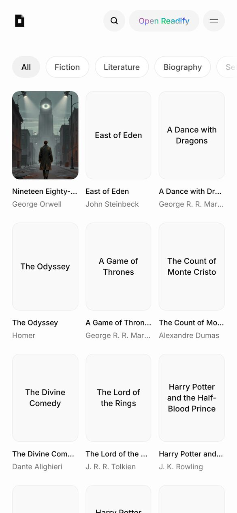

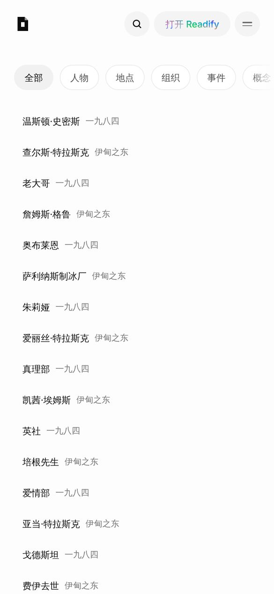
</p>

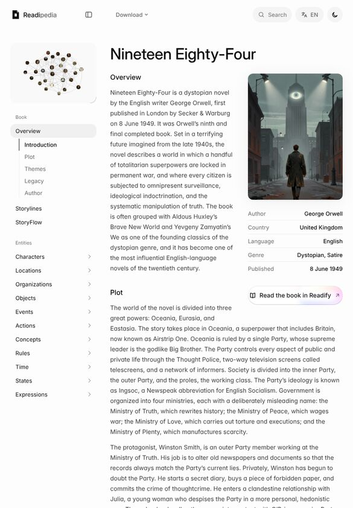
