# Readipedia 移动端 UI/UX 交互系统评审报告

> 信息层级、行为路径、状态流转与图谱手势专项评审  
> 评审日期：2026-08-28  
> 评审版本：`461ad4a`  
> 评审方式：只读源码审查 + 本地真实页面浏览器窗口模拟  
> 说明：本轮只新增本报告和原始截图证据，未修改 `app.js`、`style.css`、`index.html` 或数据文件。

## 1. 执行摘要

本次评审不是对颜色、圆角和间距的表层评价，而是从真实用户任务出发，检查移动端的信息是否容易找到、动作是否得到符合直觉的反馈、内容页与覆盖层之间能否稳定流转，以及触摸手势是否具有唯一且可预测的结果。

当前产品已经具备关系图谱、词条、目录、Storylines 与 StoryFlow 等完整内容形态，图谱的基础物理反馈也已经明显改善。但响应式布局、触摸手势、应用内页面状态和浏览器历史分别由不同机制控制，导致问题具有明显的系统性：

- 同一视口可能同时处于“CSS 桌面布局”和“JavaScript 移动行为”。
- 同一次触摸可能被节点拖拽、画布平移、图谱收起和侧栏开合共同解释。
- 界面已经切换到新词条，但 URL、浏览器返回和刷新并不知道发生了导航。
- 移动侧栏沿用数据表结构，将高价值内容入口放在 148 个实体之后。
- Storylines 在一个手机画面中叠加了页面纵滚、叙事内滚和胶片横滚。

因此，现阶段最大的风险不是某个动画参数不够自然，而是**交互行为缺少唯一所有权，界面状态缺少唯一来源**。继续追加局部判断会扩大状态组合和回归范围。

| 等级 | 数量 | 含义 |
|---|---:|---|
| P0 | 4 | 主行为路线中断、状态丢失、入口无结果或高频误操作风险 |
| P1 | 7 | 任务仍可完成，但查找、理解和操作成本明显偏高 |
| P2 / 横向问题 | 4 类 | 无障碍、触摸尺寸、动态效果和安全区一致性不足 |

## 2. 评审范围与方法

### 2.1 评审范围

- 移动正文阅读与浮动图谱入口
- 移动侧栏、实体目录和主内容入口
- 小窗/大窗关系图谱
- 节点选择、二次确认、拖拽、画布平移和页面跳转
- Storylines 与 StoryFlow
- 竖横屏切换、浏览器返回、刷新和状态恢复
- 语言切换
- 触摸目标、焦点、语义和减少动态效果

### 2.2 测试窗口与导出截图尺寸

本轮使用内置浏览器对本地真实页面进行窗口尺寸模拟，不等同于物理真机测试。滚动页面的可见内容区会扣除浏览器滚动条/窗口边界，因此部分 PNG 像素小于配置窗口；全屏无滚动页面与配置值一致。下文所写尺寸均明确指“窗口配置”。

| 配置窗口 | 导出截图像素 | 用途 |
|---|---|---|
| 360×640 | 滚动页 345×613；Storylines 360×640 | 小尺寸手机：正文、侧栏、Storylines、StoryFlow、语言 |
| 390×844 | 滚动页 375×812；全屏图谱 390×844 | 常见竖屏手机：全屏图谱、节点首选、词条刷新 |
| 844×390 | 829×383 | 同一图谱状态旋转到横屏 |
| 800×600 | 785×589 | 768/1080 断点交界区域 |

### 2.3 实际行为路线

1. 正文 → 打开图谱 → 选择节点 → 再次确认 → 阅读词条。
2. 侧栏 → 小图谱 → 展开大图谱 → 关闭 → 返回侧栏。
3. 图谱内点击、轻微位移、节点拖拽、画布平移和纵向滑动。
4. 侧栏顶部 → 滚过完整实体树 → Storylines / StoryFlow。
5. Storylines 横向胶片与叙事阅读。
6. 实体词条 → 刷新页面。
7. 竖屏打开全屏图谱 → 原状态旋转到横屏。
8. 切换中文 → 核对标题、正文、元数据和文档语言。

### 2.4 证据等级

- **本地真实页面复现**：已在本地页面与指定浏览器窗口配置中实际触发；不代表物理真机结论。
- **源码确认**：由确定性代码路径直接证明。
- **结构性风险**：源码存在明确冲突条件，但静态截图不能完整表达触摸过程，仍需真机触摸回归。

## 3. 总体诊断：五个系统没有共用同一状态

| 系统 | 当前状态来源 | 直接后果 |
|---|---|---|
| 响应式布局 | CSS 768px、JS 768px/1080px 多套判断 | 769–1080px 混合模式，旋转时交互模型突变 |
| 输入与手势 | ForceGraph、document、图谱容器、检视面板分别监听 | 一次触摸可能产生多个解释 |
| 页面导航 | 内存变量、DOM display、class | 返回、刷新、分享无法恢复当前内容 |
| 信息架构 | 数据分类及全量实体顺序 | 高频入口被埋在 148 个实体之后 |
| 控件语义 | 可点击 div、无 href 锚点、canvas | 键盘、焦点、辅助技术与视觉状态不同步 |

---

## 4. P0 问题

### UX-01｜769–1080px 响应式交互模型冲突，旋转会中断图谱状态

**等级与证据：** `P0｜本地真实页面复现 + 源码确认`

**用户路径 A**

> 800×600 打开首页 → 点击左上菜单。

**实际结果**

点击前后，侧栏都固定在 `x=0`、宽 `260px`，计算样式均为 `position: fixed; transform: none`。点击只把 class 从 `wiki-sidebar` 改成 `wiki-sidebar is-open`，没有任何可见开合结果；与此同时，正文被压缩成很窄的一列，两端对齐产生异常大的字间空隙。

| 点击前 | 点击后 |
|---|---|
|  | 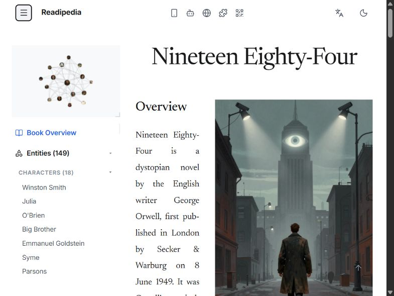 |

> 图 01A–B｜窗口配置 800×600，导出 785×589｜点击菜单后视觉布局没有变化，仅按钮获得焦点边框；侧栏仍固定，正文仍被挤压。

**用户路径 B**

> 390×844 打开全屏图谱 → 不关闭图谱，直接旋转到 844×390。

| 竖屏全屏图谱 | 同一状态旋转后 |
|---|---|
| 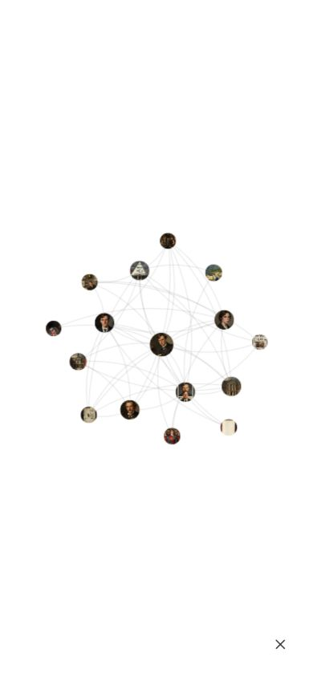 | 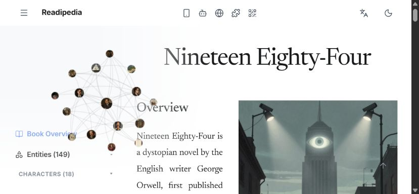 |

> 图 01C–D｜窗口配置 390×844 → 844×390；导出 390×844 → 829×383｜竖屏的全屏图谱与关闭按钮，旋转后直接变成左上角桌面浮窗；移动端关闭入口和检视区域消失，图谱覆盖正文标题与目录。

**源码证据**

- `style.css:1222-1228`：≥769px 隐藏移动端图谱组件。
- `style.css:1261-1262`：仅 ≤768px 启用移动抽屉布局。
- `app.js:2291-2305`：侧栏行为却将 ≤1080px 视为移动端并切换 `.is-open`。
- `app.js:1849-1852`：触屏设备在 ≤1080px 初始化移动手势。
- `app.js:854-876,1462`：节点激活、图谱尺寸和标签仍以 768px 为界。

**系统性原因**

CSS 布局模式、JavaScript 行为模式和触摸能力判断没有读取同一个响应式状态；视口旋转只是触发多套条件重新判断，没有进行状态迁移。

**用户影响**

- 菜单看起来可操作，实际没有结果。
- 旋转会让当前关闭入口和节点操作上下文消失。
- 800px 左右常见平板/小窗宽度成为不可预测的混合模式。

**验收标准**

- 任一时刻只能激活一种完整交互模式。
- 768、769、800、844、1080、1081px 的布局与菜单行为一致。
- 竖横屏切换保留当前内容页、图谱展开状态、选择节点及可用关闭入口。
- 旋转过程中图谱不消失、不瞬移到另一套容器、不覆盖核心正文。

### UX-02｜应用内导航没有进入浏览器历史，刷新会丢失当前词条

**等级与证据：** `P0｜本地真实页面复现 + 源码确认`

**用户路径**

> 390×844 → 侧栏 → Winston Smith → 保持当前 URL 刷新。

| 刷新前：Winston Smith | 刷新后：Book Overview |
|---|---|
| 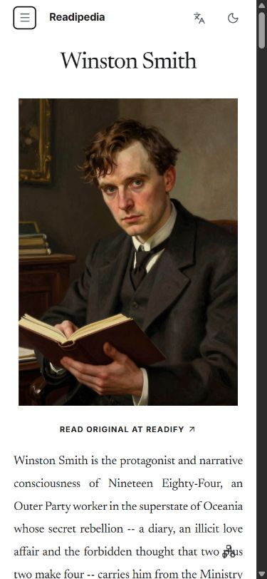 | 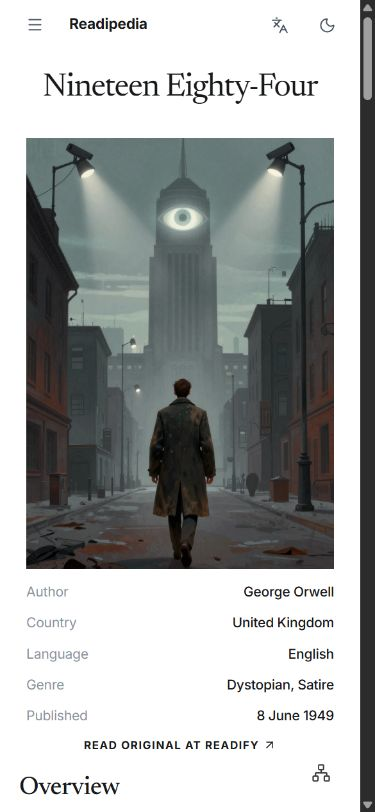 |

> 图 02A–B｜窗口配置 390×844，导出 375×812｜词条页 URL 仍为根地址 `/#`；刷新后没有恢复 Winston Smith，而是回到 Book Overview。

**源码证据**

- `app.js:13-23`：页面和图谱状态仅存于运行时内存。
- `app.js:163-220`：入口阻止默认链接行为后直接切换内存视图。
- `app.js:2129-2148`：`showArticleView()` 只修改 display、滚动位置和侧栏状态。
- 全仓没有 `pushState`、`replaceState`、`popstate`、路径或查询参数路由。
- `index.html:141-158` 等实体锚点没有 `href`。

**系统性原因**

“页面切换”只发生在 DOM 中，没有形成可序列化的导航状态，也没有与浏览器历史建立映射。

**用户影响**

- 刷新、分享链接和新标签页无法恢复当前词条。
- 浏览器返回不能稳定表达“关闭选择 → 关闭大图谱 → 关闭侧栏 → 上一词条”。
- 用户会把内容丢失误认为操作失败。

**验收标准**

- URL 能唯一表达 Book Overview、实体、Storylines、StoryFlow 和当前场景。
- 刷新后恢复当前内容及必要的图谱/选择上下文。
- 浏览器返回顺序清晰且与覆盖层层级一致。
- 实体链接可复制、分享并在新标签页打开。

### UX-03｜StoryFlow 主 CTA 是无结果入口

**等级与证据：** `P0｜本地真实页面复现 + 源码确认`

**用户路径**

> 360×640 → 侧栏底部 → StoryFlow → 点击第一个 “Explore StoryFlow”。

| 点击前 | 点击后 |
|---|---|
| 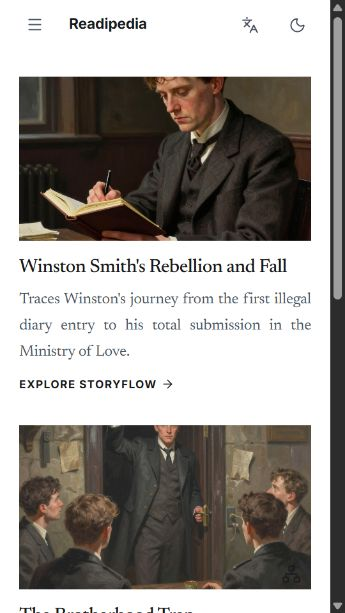 | 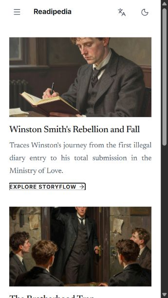 |

> 图 03A–B｜窗口配置 360×640，导出 345×613｜点击后没有进入任何新内容或详情，仅发生 `#` 锚点跳转以及相应的焦点/滚动变化。主按钮的视觉承诺与实际行为不一致。

**源码证据**

- 三个 CTA 都是 `href="#"`：`index.html:657,668,679`。
- `app.js` 没有对应 CTA、卡片或 StoryFlow 内容的处理器；现有逻辑只处理侧栏入口切到 StoryFlow 列表。

**用户影响**

这是明确的任务死路。用户已经阅读卡片说明并作出进入决策，但系统没有反馈、错误说明或后续内容。

**验收标准**

- 所有主 CTA 都产生明确、可见且可返回的结果。
- 未实现的功能不以可用主按钮呈现。
- 点击后 URL、标题、当前项状态和浏览器返回同步更新。

### UX-04｜图谱与页面手势缺少统一仲裁，同一次触摸可能被多个系统消费

**等级与证据：** `P0｜本地真实页面复现 + 源码确认；触摸过程仍需物理真机连续帧回归`

**已复现现象**

在移动全屏图谱中，极小位移可能让一次节点点击变成拖拽或画布移动，表现为节点没有进入、图谱位置先变化再回归。节点首次选中后，页面底部仅出现名称和很淡的箭头，用户难以判断下一步应该再次点击、上滑还是等待。

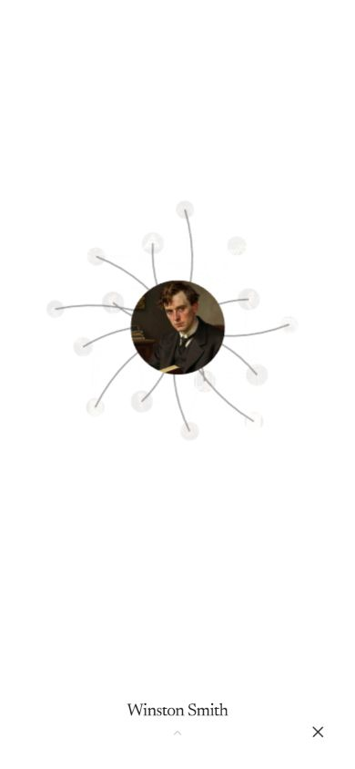

> 图 04｜窗口配置/导出均为 390×844｜首次选中 Winston Smith 后，图谱居中是正确基线；底部只显示名称与低对比箭头。移动端不应恢复 Web 悬停 tooltip，问题在于触摸意图和二阶段动作缺少清晰反馈。

**源码证据**

- `app.js:887-903`：图谱展开后统一启用 zoom、pan 和 node drag，没有移动端仲裁层。
- `app.js:1486-1511`：所有端共享节点拖拽回调。
- 桌面专用点击/拖拽位移判定仅见 `app.js:708-711,768-833`；移动激活直接进入 `app.js:854-870`。
- `app.js:1933-1972`：检视面板上下滑负责导航/收起。
- `app.js:1975-2006`：整个图谱容器又用纵向滑动收起。
- `app.js:1859-1896`：侧栏横滑监听在 `document` 上，没有边缘起点和交互区排除。
- `style.css:1076-1083`：Storylines 胶片本身又是横向滚动区。

**系统性原因**

系统没有先识别用户意图再交给唯一处理者；节点、画布、检视面板、图谱容器和全局侧栏分别在事件结束时作出判断。

**用户影响**

- 点击可能没有进入词条，反而移动图谱。
- 拖拽、平移、纵向收起和横向开侧栏的结果不可预测。
- Storylines 横滑与侧栏开合存在源码可确认的竞争；与浏览器/系统边缘返回则属于结构性风险，需物理真机验证。

**验收标准**

- 同一次触摸只能产生一个最终意图：点击、节点拖拽、画布平移、纵向收起或边缘侧栏滑动。
- 点击具有统一位移/时间阈值；识别为拖拽后不得再触发进入。
- 侧栏滑动只从明确边缘起始，且排除图谱、胶片、按钮和可横滑控件。
- 连续执行“点选/轻微移动/拖拽/平移/收起”各 30 次，无双重触发。
- 节点拖拽仍应自然影响周围图谱，松手后以阻尼回归确定性初始布局；不能为了防误触把图谱改成完全静止。

---

## 5. P1 问题

### UX-05｜移动侧栏按数据库结构堆叠，核心入口被埋在 148 个实体之后

**等级与证据：** `P1｜本地真实页面复现 + 源码确认`

| 侧栏顶部 | 滚动到底部后 |
|---|---|
| 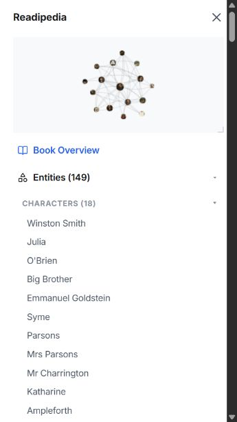 | 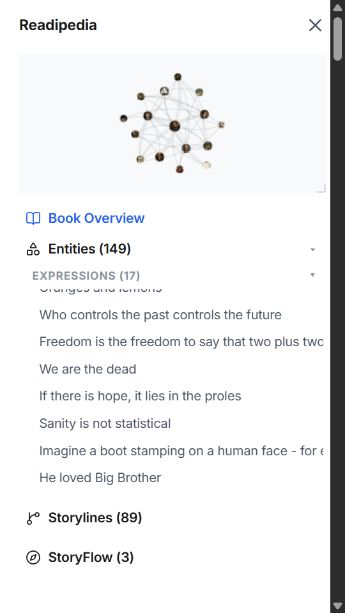 |

> 图 05A–B｜窗口配置 360×640，导出 345×613｜侧栏可滚动区域实测 `scrollHeight=4845px`、`clientHeight=431px`。Storylines 和 StoryFlow 位于完整实体树之后，用户必须滚动约 4.4k px 才能看到。

**源码证据**

- `index.html:133` 的实体根节点默认 `open`。
- 11 个分类在 `index.html:138,161,183,198,218,239,248,270,303,311,319` 均默认 `open`。
- Storylines / StoryFlow 直到 `index.html:345-355` 才出现。
- UI 显示 `Entities (149)`，实际 `.entity-toc-link` 为 148 项。

**用户影响**

- 用户先看到的是数据结构，不是高频任务。
- 当前词条、最近访问、搜索、Storylines 和 StoryFlow 没有优先层级。
- 超长列表增加滚动、定位和返回成本。

**验收标准**

- 当前词条、搜索/筛选、最近访问、Storylines 和 StoryFlow 在两次明确操作内可达。
- 分类默认状态由移动任务决定，而不是全部展开。
- 当前实体自动滚入可见区域并有明确当前项状态。
- 总数与真实可访问条目一致。

### UX-06｜Storylines 在手机上形成三层滚动，并浪费主要阅读空间

**等级与证据：** `P1｜本地真实页面复现 + 源码确认`

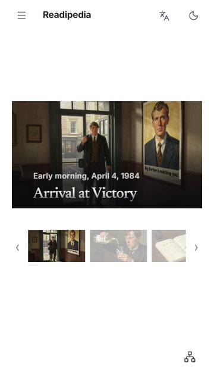

> 图 06｜窗口配置/导出均为 360×640｜首屏没有 Storylines 页面标题、当前进度或明确的上一/下一场景；16:9 画面与三个缩略图被垂直居中，大量上下空间空置。

**真实测量**

- 叙事框：`clientHeight=61px`，但 `scrollHeight=1094px`。
- 胶片轨道：`clientWidth=266px`，但 `scrollWidth=9248px`。
- 页面容器：360×588，因 `wide-stage` 规则垂直居中。

**源码证据**

- 固定 16:9：`style.css:958-964`。
- 叙事区 `max-height:40%` 且 `overflow-y:auto`：`style.css:1015-1024`。
- 胶片轨道 `overflow-x:auto`：`style.css:1076-1083`。
- 宽舞台强制垂直居中：`style.css:699-705`。
- 左右箭头只平移胶片 320px，并不切换场景：`app.js:242-253`。

**用户影响**

用户需要同时理解页面纵向、叙事框纵向和胶片横向三套滚动；89 个场景只有桌面 hover title，没有适合触摸的序号和标题浏览方式。

**验收标准**

- 移动端只有一个主要纵向阅读容器。
- 显示页面标题、当前场景序号（如 1/89）、场景标题和明确前后场景入口。
- 选中场景后正文不在 61px 高的内层窗口中阅读。
- 胶片横滑不触发侧栏或系统返回手势。

### UX-07｜图谱二阶段触摸交互可用，但行动提示不足

**等级与证据：** `P1｜本地真实页面复现`

证据见图 04。当前“首次点击选中并居中、第二次确认进入”的模型本身适合移动端，也符合用户要求；问题不是缺少桌面 hover tooltip，而是首选后只显示节点名和低对比箭头，无法解释二次动作。

**验收标准**

- 保留移动端首次选中/居中、第二次确认进入的模型。
- 不在移动端引入桌面悬停名称。
- 首选后清晰展示完整名称、进入方式和取消方式，不依赖 hover。
- 长名称可完整查看，底部提示不与系统手势区冲突。

### UX-08｜浮动图谱入口覆盖正文元数据

**等级与证据：** `P1｜本地真实页面复现`

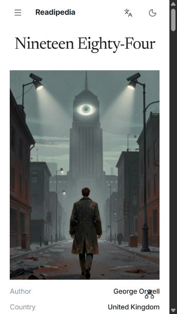

> 图 07｜窗口配置 360×640，导出 345×613｜右下角固定图谱按钮覆盖 Author / George Orwell 行，正文滚动时会持续压在内容之上。

**用户影响**

固定入口抢占阅读内容和点击区域；在小屏、安全区或长文本场景下遮挡会更明显。

**验收标准**

- 360、390、430px 及安全区环境下不覆盖正文、元数据和其他控件。
- 触摸区域至少达到 44×44px，但不以遮挡内容为代价。
- 页面底部、滚动中和横屏都保持稳定位置。

### UX-09｜语言切换只改变局部标题，语言状态与真实内容不一致

**等级与证据：** `P1｜本地真实页面复现 + 源码确认`

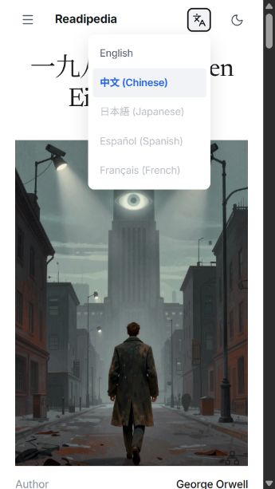

> 图 08｜窗口配置 360×640，导出 345×613｜菜单明确显示“中文 (Chinese)”已选，标题仅部分中文化，但元数据、正文和导航仍为英文；实测 `<html lang>` 仍是 `en`。

**源码证据**

- `index.html:2`：文档语言固定为 `lang="en"`。
- `index.html:68-74`：语言选项是普通 div。
- `app.js:2350-2361`：选择后只更新 `state.lang` 并调用 `renderBookArticle()`。
- `app.js:102-105`：只有标题具有中英文分支；`app.js:107-132` 继续使用同一英文正文数据。

**验收标准**

- 当前可见页面、导航、按钮、元数据、ARIA 文本和 `<html lang>` 同步更新。
- 实体、Storylines、StoryFlow 与 Book Overview 使用同一语言状态。
- 如果当前只支持局部翻译，界面必须明确说明，不能表现为全局语言切换。

### UX-10｜实体页缺少所属类别与稳定的目录当前位置

**等级与证据：** `P1｜源码确认 + 本地真实页面观察`

实体页只显示标题、图片和正文，没有 Character / Location / Event 等所属类型。`app.js:2183-2192` 已计算 `foundCat` 并尝试写入 `#view-entity-cat`，但 `index.html:418-433` 的实体视图没有这个元素，信息在渲染链路中丢失。

当前项自动滚动只在侧栏已经打开时运行（`app.js:2161-2175`），从图谱进入词条后再打开侧栏，用户不一定能立即看到自己所在的位置。

**验收标准**

- 词条标题区展示所属类型。
- 侧栏具有 `aria-current` 和清晰可见的当前项。
- 从图谱、搜索或其他词条进入后，重开侧栏时当前项自动进入视口。

### UX-11｜关闭并重开侧栏可能保留陈旧节点选择

**等级与证据：** `P1｜源码确认`

`app.js:2272-2280` 的 `closeMobileSidebar()` 只移除侧栏和 backdrop class，不清理 focused node 或检视状态。用户在侧栏小图谱中选中节点后关闭侧栏，再次打开时可能看见旧选择；更危险的是隐藏的首次选择可能让下一次点击被解释成“第二次确认”。

**验收标准**

- 产品明确选择“保留”或“清除”，视觉状态和下一步行为必须一致。
- 不允许隐藏选择在重开后改变首次点击语义。
- 侧栏、文章大图谱和移动全屏图谱的选择状态迁移规则统一。

---

## 6. P2 与横向品质问题

### 6.1 触摸目标偏小

- 菜单 32×32：`style.css:132-143`。
- 图谱展开 28×28：`style.css:362-377`。
- 侧栏关闭 32×32：`style.css:1340-1353`。
- 移动图谱开/关 42×42：`style.css:1386-1404,1477-1495`。
- 胶片箭头只有小字体与 padding：`style.css:1059-1069`。

建议所有高频移动目标具备至少 44×44px 的实际点击区域，并保留足够间隔。

### 6.2 可访问性状态与视觉状态不同步

全仓没有 `aria-expanded`、`aria-current`、`aria-selected`、`aria-live`、`aria-hidden`、`inert` 或焦点管理规则。实体锚点没有 `href`，语言选项、节点检视面板和 89 个 Storyline 缩略图是可点击 div；canvas 没有等价的可访问节点列表。

结果是：关闭的抽屉仍可能留在辅助技术访问树中，打开后焦点不进入，关闭后焦点不返回，当前词条/场景没有机器可读状态。

### 6.3 减少动态效果覆盖不完整

`style.css:30-35` 只覆盖部分图谱和 inspector；分类开合仍固定 320ms（`app.js:48-93`），抽屉固定 300ms（`style.css:1292-1295`），手势提示仍无限循环（`style.css:1577-1595`）。应由一个全局 motion token 同时控制 CSS 与 JS 动画。

### 6.4 安全区与动态视口

移动抽屉使用 `100vh`，而不是动态视口高度；普通头部和横屏左右区域没有完整 safe-area 规则。地址栏伸缩、刘海和底部系统手势区可能改变真实可用空间，并触发 resize 后的图谱重新适配。

---

## 7. 必须保留的正确交互基线

以下行为已经符合当前产品方向，后续系统性重构不能为了修复其他问题而破坏：

1. **移动端不显示桌面 hover tooltip/title。** 触摸端没有稳定悬停语义。
2. **移动端首次点击节点用于选择并居中，第二次确认进入词条。** 应改善提示，不应取消模型。
3. **从侧栏小图谱展开后，关闭大图谱应返回侧栏。**
4. **从文章浮动入口展开后，关闭大图谱应返回文章。**
5. **桌面大窗点击节点切页时，大窗保持展开。**
6. **节点拖拽应自然影响周围图谱，松手后以阻尼回归确定性初始布局。** 不应把周围节点锁死，也不应在回归时重新 fit 导致整图缩小或偏移。
7. **Web 大窗的模糊透明视觉效果属于既有设计资产。** 响应式和状态修复不应通过删除该效果解决。

## 8. 系统性解决路线

### 第一阶段：统一模式与状态来源

- 定义唯一响应式交互画像，由布局、图谱和手势共同读取。
- 明确是否存在独立 Tablet 模式；如果没有，769–1080px 必须完整归入移动或桌面之一。
- 将当前页面、侧栏、图谱来源、展开状态、选中节点和语言收敛到可序列化状态。
- 建立 URL/history 映射和覆盖层返回优先级。

### 第二阶段：建立唯一手势仲裁

- 触摸开始只进入“候选”状态，根据位移、方向、速度、起点和目标区域决定唯一意图。
- 建议状态至少区分：`candidateTap`、`nodeDrag`、`canvasPan`、`verticalDismiss`、`edgeDrawerSwipe`。
- 一旦意图确定，其余处理器必须取消；不能在 `touchend` 时各自补判。
- 图谱拖拽物理与布局回归只由图谱系统负责，禁止通过全局 fit/resize 兜底。

### 第三阶段：重构移动信息架构

- 将当前词条、搜索/筛选、最近访问、Storylines、StoryFlow 提升到第一层。
- 实体分类按需展开，并显示当前项与所属类型。
- 为 Storylines 建立移动专用阅读结构：单一纵向阅读、明确进度与前后场景。

### 第四阶段：语义、尺寸与动态品质

- 使用真实 link/button，补齐 ARIA 状态、焦点陷阱与焦点返回。
- 统一 44px 触摸目标、安全区和动态视口。
- 用统一 motion token 覆盖 CSS/JS，并完整支持 reduced motion。
- 语言状态覆盖所有视图与辅助技术语义。

## 9. 回归验收矩阵

| 路线 | 视口/环境 | 必须验证 |
|---|---|---|
| 正文 → 图谱 → 节点 → 词条 | 360×640、390×844 | 首选居中、二次进入、无误拖拽、可返回 |
| 侧栏 → 小图谱 → 大图谱 → 关闭 | 360×640、390×844 | 返回侧栏，选择状态规则一致 |
| 文章入口 → 大图谱 → 关闭 | 360×640、390×844 | 返回文章，不进入侧栏 |
| Web 大窗连续节点切页 | ≥1081px | 大窗保持、图谱位置确定、阅读区可滚动、透明效果保留 |
| 竖屏图谱 → 横屏 → 竖屏 | 390×844 ↔ 844×390 | 状态连续、入口不消失、图谱不闪现/越界 |
| 菜单开合 | 768、769、800、844、1080、1081px | 布局与行为不混合 |
| Storylines 横滑与阅读 | 360、390、430px | 单一纵滚、横滑不触发侧栏/返回 |
| 实体 A → B → 返回 → 刷新 | 手机与桌面 | URL、标题、当前项和内容一致 |
| 中文切换 | 所有内容视图 | 可见文案、元数据、ARIA、`html lang` 同步 |
| 连续快速操作 | 触屏与鼠标 | 无二段闪现、重复动画、残留选择和双重触发 |

## 10. 结论

当前移动端问题不应拆成若干互不相关的小 bug。多个真实问题都指向同一结构性事实：**布局、输入、状态、导航和信息层级没有形成统一的交互系统**。

下一轮优化应首先减少状态来源和手势处理者，而不是增加条件分支。验收也不能只检查某一张画面是否正确，而要检查完整行为路线：用户从哪里进入、系统如何识别意图、切换后保留什么状态、返回时回到哪里，以及旋转、刷新和快速连续操作后是否仍然成立。

只有这些基础机制稳定后，图谱动效、尺寸和视觉细节的优化才不会继续制造新的回归。

## 附录 A：原始截图索引

| 文件 | 真实问题/状态 | 配置窗口（导出尺寸见 2.2） |
|---|---|---|
| `01-mobile-initial-launcher-overlap-360x640.png` | 浮动图谱按钮覆盖正文元数据 | 360×640 |
| `02-mobile-sidebar-top-360x640.png` | 侧栏顶部默认全展开 | 360×640 |
| `03-mobile-sidebar-bottom-primary-nav-buried-360x640.png` | Storylines / StoryFlow 位于 148 项之后 | 360×640 |
| `04-mobile-storylines-nested-scroll-360x640.png` | Storylines 空间浪费与多层滚动 | 360×640 |
| `05-mobile-storyflow-cta-360x640.png` | StoryFlow CTA 点击前 | 360×640 |
| `05b-mobile-storyflow-after-cta-click-360x640.png` | CTA 点击后无结果、URL 变 `#` | 360×640 |
| `06a-tablet-breakpoint-before-menu-800x600.png` | 混合断点菜单点击前 | 800×600 |
| `06b-tablet-breakpoint-after-menu-800x600.png` | 点击后布局无变化 | 800×600 |
| `07-graph-portrait-expanded-390x844.png` | 竖屏移动全屏图谱 | 390×844 |
| `08-graph-landscape-after-rotation-844x390.png` | 旋转后突变为桌面浮窗 | 844×390 |
| `09-mobile-graph-node-first-selection-390x844.png` | 节点首选与二阶段提示 | 390×844 |
| `10-mobile-language-zh-selected-english-content-360x640.png` | 中文已选但内容仍主要为英文 | 360×640 |
| `11a-mobile-entity-before-refresh-390x844.png` | Winston Smith 刷新前 | 390×844 |
| `11b-mobile-after-refresh-state-lost-390x844.png` | 刷新后回到 Overview | 390×844 |
